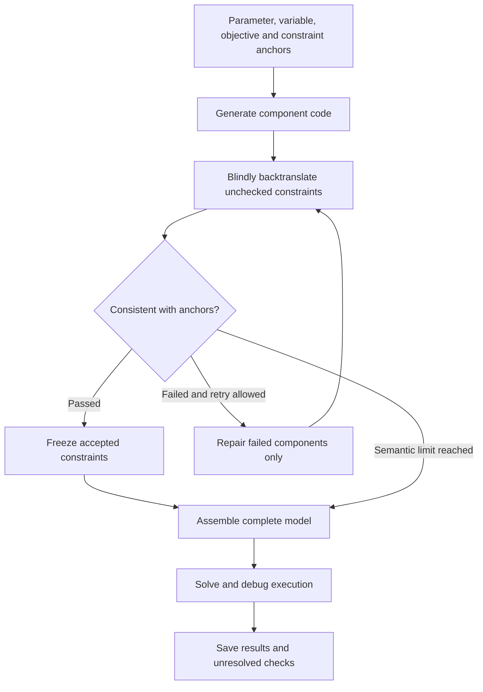

SAC-Opt preserves business meaning as semantic anchors, translates constraint code back into language, and compares that translation with the anchors. Failed constraints are repaired selectively; accepted components are frozen.

## Why read code backwards

“Each employee works at most five days” requires summing over dates. Summing over employees can instead mean “at most five employees per day.” Both programs may execute while expressing different rules.

The backtranslator reads constraint code and context to state its expressed rule. A comparator checks that translation against the original semantic anchor and returns a pass or repair decision.

## Workflow and constraint-level example



```walkthrough
[
  {"title":"Keep anchors","nodes":["Anchors"],"body":"Define binary x[e,d] for employee e and date d. Preserve requirements with their quantifiers and index meanings.","artifact":"x[e,d] = 1 if employee e works on date d.\nC1: each employee works at most 5 days.\nC2: at least 3 employees each day."},
  {"title":"Backtranslate","nodes":["Generate","Translate"],"body":"Suppose C1 mistakenly sums over employees. The translation reveals that it actually limits daily headcount.","artifact":"Hypothetical error: for each d, sum(x[e,d] for e in E) ≤ 5\nTranslation: at most 5 employees each day."},
  {"title":"Selective repair","nodes":["Compare","Repair","Freeze"],"body":"Repair C1's quantifier and summation direction. Freeze C2 if it passed, avoiding unrelated rewrites.","artifact":"Repair C1: for each e, sum(x[e,d] for d in D) ≤ 5\nFreeze C2: for each d, sum(x[e,d] for e in E) ≥ 3"},
  {"title":"Assemble and run","nodes":["Assemble","Solve","Finish"],"body":"Assemble checked components and execute the complete model. Preserve an explicit unresolved status if semantic checks exhaust their budget.","artifact":"Semantic consistency: recorded per constraint\nExecutability: checked on the complete program\nNumerical plan: returned by the actual backend"}
]
```

## From four anchor types to code

Parameter and variable anchors capture symbols, shapes, units, domains and bounds. The current implementation retains parameters and variables with confidence scores above 3; low-confidence constraints receive further assessment. Code is generated as setup, objective and individual constraints, with component counts checked against anchors.

Full attachments remain accessible through `build_model(data)`. Submitting several components together changes orchestration, not the unit of judgment: each constraint still receives its own consistency decision.

## Limits and failure interpretation

Defaults allow five parse attempts, five semantic rounds and three full-program executions. Semantic checking and execution debugging are separate loops: one checks meaning, the other handles runtime failures.

A repair produced after the final failed comparison cannot be presented as independently passed. The platform keeps unresolved failures alongside actual solver results. Inspect both the failed constraints and the code associated with the numerical result.

## When to consider this workflow

Use it for LP/MILP problems with many rules, fragile indices or quantifiers, and a need to inspect individual constraints. It does not judge model quality from objective values alone. Compared with [TriVAL](../trival/), its focus is anchor-to-constraint-code consistency. Compared with [Feedback Repair](../feedback-repair/), repair is more granular.

## Platform implementation and sources

This is an independent implementation of the [published algorithm](https://proceedings.mlr.press/v306/zhang26cb.html), using prompts written by this project. The pinned reference is [Forrest-Stone/SAC-Opt](https://github.com/Forrest-Stone/SAC-Opt/tree/ec0ddb544ae6b70714181740ebbba16027df50e4). The platform retains anchors, blind backtranslation and selective repair, with batched components and native-model contracts. The published source records the component and contract adaptations.
