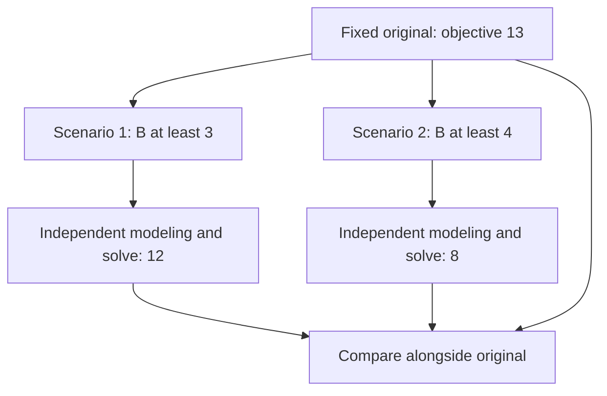
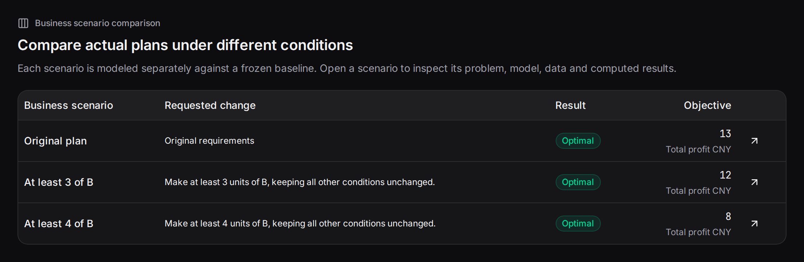

Business scenarios compute several explicit changes from one saved plan. Compare demand, budgets, capacities, availability or supply conditions.

## Create a scenario group

Choose “Business scenario comparison” below a result. Enter names and changes for 2–6 scenarios. Names identify results; changes become revised problem statements. Each run uses the common inputs and original configuration.

```text
Scenario 1: regular order, at least 3 units of B.
Scenario 2: larger B order, at least 4 units of B.
```

You can also request several scenarios in one plan-conversation message, then compare the batch.

## Branching from one baseline



Every scenario saves its statement, code, execution and result. Scenario conversation retains the original current baseline; select a scenario explicitly to continue from it.

## A complete comparison

| Plan | A | B | Profit |
|---|---:|---:|---:|
| Original | 3 | 2 | 13 |
| B≥3 | 2 | 3 | 12 |
| B≥4 | 0 | 4 | 8 |



Read status and objective, then changed decisions. The table prioritizes the first 20 changed same-named variables. Open a run for complete values and inputs.

## Try creating and selecting scenarios

Choose “Compare B≥3 and B≥4” below to see results and the current baseline. Then select the original or request another change.

```demo
plans
```

## Useful scenario patterns

| Business question | Changes |
|---|---|
| Demand growth | Raise product/store demand separately |
| Staff absence | Make an employee unavailable on a date |
| Budget negotiation | Compare total spending caps |
| Maintenance | Reduce capacity on selected dates |
| Supply disruption | Change warehouse supply or disable routes |

Specify objects and values, keeping objective meanings and units aligned. For cumulative changes, apply [revisions](../revisions/) successively.

## Recording and archiving

The middle of the recording shows scenario entry and the comparison table. Each scenario has its own link and supports Excel export, tags and notes.

```video
workbench
```
