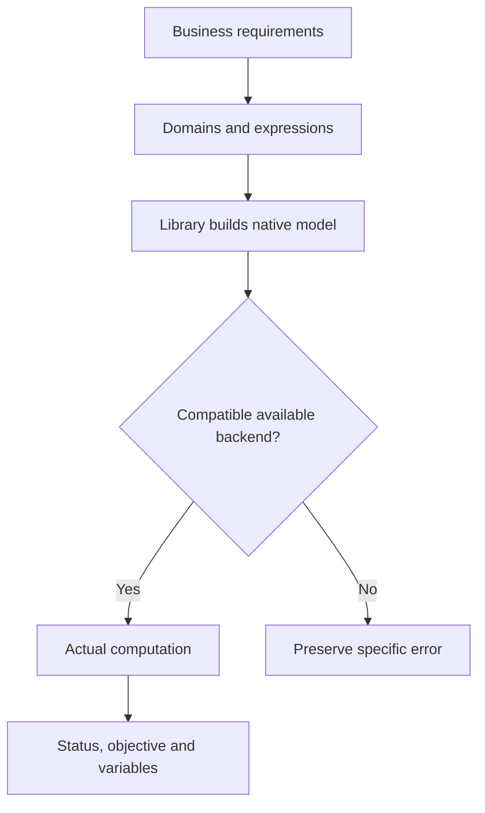

Choose the mathematics first, then the modeling library and backend. A library expresses a model; a backend computes it.

## Start with variables and constraints

| Structure | Mathematics | Combinations to inspect |
|---|---|---|
| Divisible quantities and linear expressions | LP | Pyomo / PuLP with compatible HiGHS, CBC or other engines |
| Whole units, switches or locations with linear constraints | MILP | Pyomo, PuLP, gurobipy, PySCIPOpt, coptpy or OR-Tools mathematical programming |
| Scheduling, logic, exclusion and finite domains | CP / SAT-style discrete constraints | CPMpy with OR-Tools, or OR-Tools CP-SAT |
| Convex quadratic losses, norms or cones | Convex QP / conic programming | CVXPY with compatible OSQP, Clarabel, SCS or other engines |
| Smooth nonlinear continuous decisions | NLP | CasADi with Ipopt or another suitable native path |
| Routing, flow, assignment or knapsack | Specialized combinatorial structure | The corresponding OR-Tools interface |

Staffing can be MILP; production can include nonlinear losses. Domains and expression structure determine the mathematical requirements.

## The complete solving chain



The method translates requirements; the library constructs a native object; the engine applies algorithms to it. OR-Tools CpModel and MathOpt are native APIs selected through model code.

## Try the production model

Change hours, minimum demand and quantity domain to inspect quantities, objective and resource use.

```demo
production
```

Run the same statement in the workbench to retain the model, code and complete result, then continue with revised conditions.

## What the nine libraries express

| Library | Expressions and interfaces | Default or native path |
|---|---|---|
| [Pyomo](../pyomo/) | Indexed algebraic models, Concrete/instantiated Abstract, Kernel | Algebraic HiGHS; Kernel CBC |
| [gurobipy](../gurobipy/) | Native Gurobi scalar and matrix models | Gurobi |
| [OR-Tools](../ortools/) | Mathematical programming, CP, Routing, graph algorithms | Interface-specific; MPSolver reference uses SCIP |
| [CPMpy](../cpmpy/) | Finite-domain integer, Boolean and global constraints | OR-Tools CP-SAT by default |
| [PuLP](../pulp/) | Linear objectives and constraints | CBC by default; other compatible native backends |
| [CVXPY](../cvxpy/) | DCP, DGP, DQCP and conic expressions | Compatible installed solver path |
| [PySCIPOpt](../pyscipopt/) | Native SCIP linear, integer and nonlinear constraints | SCIP |
| [CasADi](../casadi/) | Symbolic differentiation, Opti and native problem dictionaries | Opti NLP defaults to Ipopt |
| [coptpy](../coptpy/) | Native COPT LP/MIP, convex quadratic and conic models | COPT |

## AUTO versus explicit selection

AUTO follows native library/model logic. CVXPY can try compatible installed solvers through `solver_path`; native solver libraries use their own engines. Results record the actual backend.

Explicit selection fixes the engine. Run information retains that selection and execution feedback. See [backends and licenses](../backends/) for dependencies and configuration.

## Reading solver status

`optimal` establishes optimality for the submitted model. `feasible` provides a valid plan without the same optimality conclusion. `infeasible` means that model has no feasible solution. For `time_limit`, also inspect whether an incumbent exists.

Nonconvex NLP retains native local statuses. Routing records feasible or optimal according to its native result. The result view keeps status and actual decisions together.

## Returning code to the platform

Usually define `build_model(data)` and return a native model. Code builds without calling solve, printing results, reading files or accessing the network. The platform supplies complete attachment text and manages execution, limits, solving and persistence. Library pages show special returns for Routing managers, flow terminals and CasADi numerical arguments.
