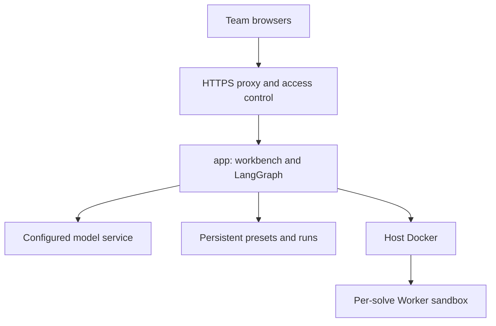

Team deployment centralizes model configuration, records and the workbench on a server. Members use a browser. This guide covers startup, access, HTTPS and maintenance.

## Start the service

Prepare Docker and Compose v2.24+, clone and configure `.env` using [installation](../installation/), then run:

```bash
docker compose up -d --build
docker compose ps
docker compose logs -f app
```

The default port is 8767. Members use `http://server-IP:8767`; configure mappings with `LLM4OM_PORT`.

## Service components



app creates Workers through the host Docker socket. Workers use disabled networking, read-only root filesystems, non-root execution and resource limits, then are removed. `llm4om-data` retains presets, history and runs.

## Shared access

The workbench uses a shared workspace: members use presets, view runs and manage notes and records. Configure team IP access or an authenticated reverse proxy at the service entrance.

The Docker socket grants app permission to create host containers; choose and configure the host accordingly. See [configuration](../configuration/) for defaults, quotas and concurrency.

## Domain and HTTPS

Point a domain at the server and open ports 80/443. Set the actual domain in `.env`:

```dotenv
LLM4OM_DOMAIN=llm4om.example.edu
LLM4OM_PORT=127.0.0.1:8767
LLM4OM_TRUST_PROXY=1
```

Then run:

```bash
docker compose --profile https up -d --build
docker compose logs -f https
```

Caddy obtains and stores certificates and forwards pages and live streams to app. `LLM4OM_TRUST_PROXY=1` counts hourly usage by forwarded client address.

## Concurrency and resources

Set active runs in `compose.override.yaml`, for example:

```yaml
services:
  app:
    command: ["llm4om", "serve", "--workspace", "/data", "--port", "8767", "--jobs", "8"]
```

`LLM4OM_SANDBOX_JOBS` separately controls all concurrent solves and checking scripts. Choose values according to model-service quotas and host resources.

## Update, migrate and back up

Run `git pull`, then `docker compose up -d --build` for updates. Apply environment changes with `docker compose up -d app`. `docker compose down` stops services while retaining data volumes.

To migrate a Python workspace, stop the target app, copy inputs into `/data/`, then start. See [backups](../configuration/) for commands and [backends](../backends/) for license mounts.
