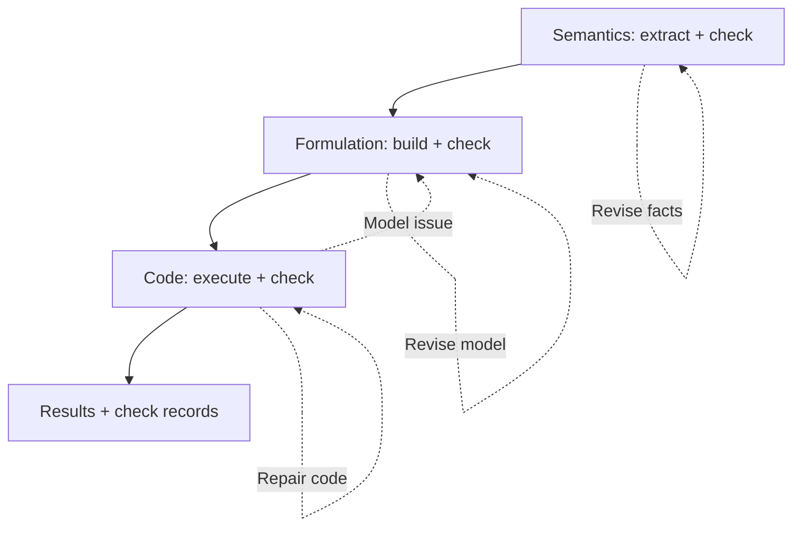

TriVAL separates three questions: was the problem understood correctly, does the formulation express that understanding, and does the code implement the formulation? Each level has construction, validation and revision. A code-stage finding can send the workflow back to the formulation.

## What each level checks

| Level | Artifacts | Example failure | Revision |
|---|---|---|---|
| Semantics | Facts, ambiguities and resolutions | Interpreting coverage per shift as a daily total | Extract facts again or revise ambiguity resolutions |
| Formulation | Parameters, indices, variables, objective and constraints | Missing per-shift coverage or reversing a minimum | Revise locally or rebuild the formulation |
| Code | Native model code and execution evidence | Wrong indices, domains or implementation | Repair code, or return to the formulation if that is the cause |

Each validation result identifies the stage to revise: extracted facts, mathematical expressions or their implementation.

## Workflow and worked example



```walkthrough
[
  {"title":"Semantic facts","nodes":["Facts"],"body":"Separate profits, processing times, resource limits and whole-unit requirements. An additional requirement of at least 3 units of B must remain a demand fact.","artifact":"Facts: whole products; 8 hours of each resource; B at least 3.\nCheck interpretation: unit net profit and processing hours per unit."},
  {"title":"Formulation","nodes":["Form"],"body":"Parameter/index, variable, objective and constraint experts construct in parallel. A selector assembles the formulation, which is checked against the facts.","artifact":"max 3A + 2B\n2A + B ≤ 8; A + 2B ≤ 8; B ≥ 3\nA, B are nonnegative integers"},
  {"title":"Execute and attribute","nodes":["Code"],"body":"If code omits B ≥ 3 but the formulation includes it, repair code. If the formulation also omits it, return to that level.","artifact":"Implementation omission → repair build_model(data)\nFormulation omission → revise formulation, then regenerate code\nThe routes address different causes."},
  {"title":"Report separately","nodes":["Finish"],"body":"The correct integer optimum is 12. The final record shows numerical results and each stage's validation status.","artifact":"Solver evidence: A = 2, B = 3, objective 12\nRecord semantic / formulation / code validation separately\nStage feedback records the final validation decision."}
]
```

## How validation failures are routed

Semantic checks distinguish faithful facts, relevant ambiguities and consistent resolutions. Faulty facts or ambiguity identification cause extraction again; inconsistent resolutions return to ambiguity resolution. Formulation checks can request partial revision or a new construction by the experts.

Code is executed before code validation. Attribution to the formulation sends the outer workflow back to that level. An upstream stage can proceed with its latest artifacts after reaching its limit. The platform reports each unpassed stage at exit.

## Reading a run effectively

Choose a rule that is easy to misinterpret and follow it through facts, formulation and code. For “each employee works at most five days,” check for an employee index with a separate constraint for each employee. Then inspect whether later artifacts actually address the validator's finding.

The run retains solver values and stage validation feedback. Comparisons can inspect status, failed stages, revisions and actual call usage.

## Requirements and budget

Select TriVAL and a library/backend supporting the intended mathematics. Each stage allows at most five validations; code execution allows twenty attempts. Total LLM use depends on nodes and return paths.

For DeepSeek, forced tool choice requires thinking mode to be disabled in the preset: `{"thinking":{"type":"disabled"}}`. See [LLM presets](../model-presets/).

## Related methods and implementation

[Feedback Repair](../feedback-repair/) reviews the model after solving; TriVAL moves checks into separate levels. [SAC-Opt](../sac-opt/) focuses on the consistency of backtranslated constraint code.

The platform ports the [pinned SCUT-EIPI/TriVAL implementation](https://github.com/SCUT-EIPI/TriVAL/tree/380a529), retaining its graph, nodes, prompts and loops. It supplies the LLM and sandbox, maps input and reports unresolved validation at exit.
