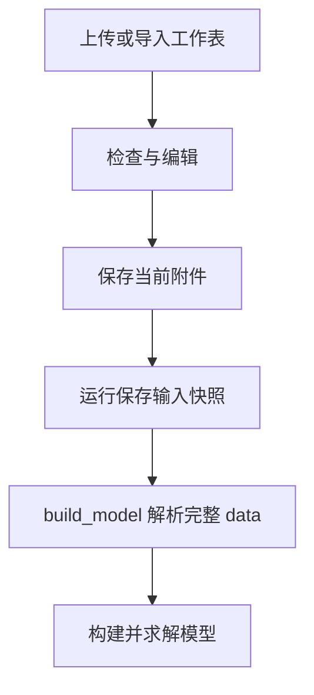

在问题中添加 Excel、CSV、TSV、JSON 或文本文件，可以让建模代码直接使用完整数据。点击文件名打开编辑器，检查字段、修改单元格或调整原文，再保存到当前需求。

## 准备文件与说明

每个上传文件最大 2 MB。Excel 的每张工作表转换为一个 CSV；文件名保留中文、空格和括号等常见字符。题面中写清文件名、字段含义、单位和索引。

例如附件 `production.json` 可包含产品、利润、工时矩阵和资源容量。配套说明为：“usage 的行对应资源，列对应产品，单位小时/件；产量按非负整数计。”

下载可直接使用的 [JSON 示例](../../../assets/examples/production.json)和[CSV 示例](../../../assets/examples/production.csv)。

## 在编辑器中检查什么

| 内容 | 操作示例 |
|---|---|
| 列名与单位 | 将“价格”改为“单件利润（元）” |
| 编号 | 保留门店001等原始文本 |
| 数值 | 修改费用、需求、可用工时 |
| 行列映射 | 核对矩阵行与仓库、列与门店的对应 |
| 文件结构 | JSON 用原文编辑；表格可切到原文 |

表格每页显示50行，翻页与保存保留全部数据；超过50列时使用原文。CSV引号和JSON语法在保存时检查，错误位置修正后即可继续。

## 试一次保存与取消

将切割容量从 8 改为 10 小时，点击“保存数据”，再点击“开始建模”。利润从 13 元变为 16 元。“取消编辑”恢复已保存的数值，下方快照保留原方案的输入和利润。

```demo
data
```

真实工作台中，点击“保存数据”应用附件修改；启动建模使用当前保存的数据。已有运行保存当时的输入，方便查看每次条件变化。

## 数据从哪里进入模型



`data` 把文件名映射到文本，代码在执行时解析。大量结构化附件可选择 [BIND](../bind/)，其生成阶段提供结构，执行阶段读取完整数值。

## 查看实际操作


点击录屏下方的“编辑数据”，直接观看打开附件、修改单件利润并保存的操作。完整流程见[快速开始](../quickstart/)。

```video
workbench
```
