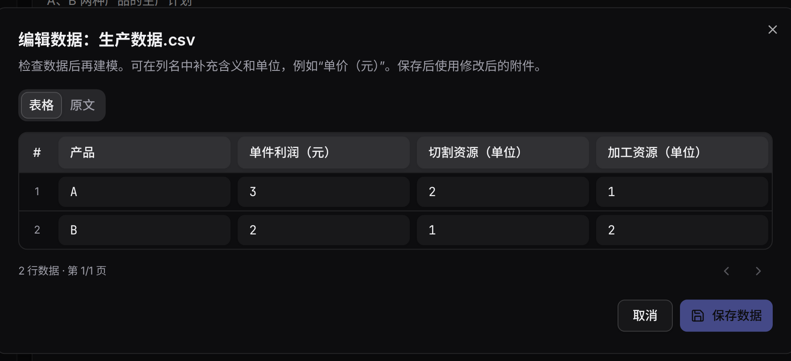

数据和问题描述共同构成建模输入。上传前说明每个字段的业务含义与单位，尤其是费用、时间、数量和编号之间的关系。

## 支持的文件

可以使用 CSV、TSV、JSON、文本，以及 Excel `.xlsx` 工作簿。Excel 的每个工作表会转为一个 CSV 文件。普通附件每个最大 2 MB；多个工作表转换后分别作为数据文件使用。

例如，生产数据可以写成：

```csv
产品,单件利润（元）,切割资源（单位）,加工资源（单位）
A,3,2,1
B,2,1,2
```

在题面中另外说明资源上限和变量域。表格提供参数，问题描述解释要怎样使用这些参数。

## 检查与编辑

点击附件名称打开编辑器。CSV、TSV 可按表格修改单元格和列名；JSON、文本通过原文编辑。每页显示 50 行，翻页和保存保留全部数据。超过 50 列时使用原文编辑。

数值保留原始文本，编号 `001` 不会自动变成 `1`。CSV 引号不完整或 JSON 格式无效时，修正后才能保存。点击“保存数据”应用修改，取消则保留原文件。



## 完整数据怎样参与计算

普通方法可能在提示中看到附件预览；生成代码通过 `build_model(data)` 读取完整内容。[BIND](../bind/)专门把 JSON/CSV 的结构交给大模型，在执行时解析完整数据，适合数据较长的场景。

## 修改数据后的方案

修改草稿或聊天附件只影响后续计算，已保存方案保留当时的数据。要按新附件更新方案，应明确要求重新建模或发起新运行，再核对新问题使用的文件。
