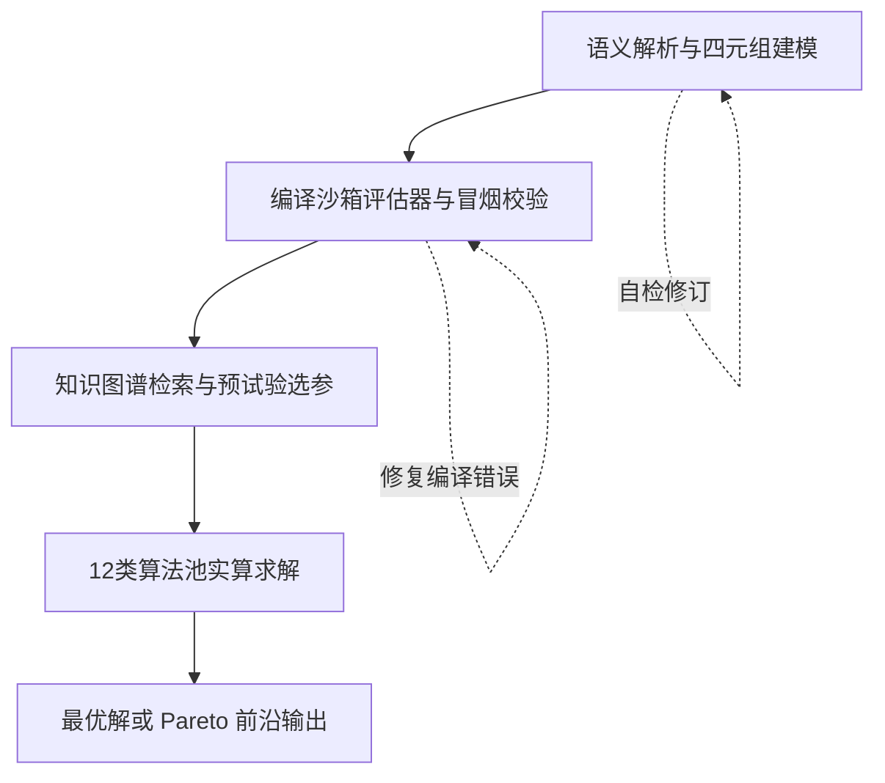

AutoCO（Automated Combinatorial Optimization，自动化组合优化）是平台的智能优化引擎。面对大规模组合调度、非线性黑盒目标或多目标权衡难题时，AutoCO 将自然语言直接编译为可在隔离沙箱中高速评估的 NumPy 问题对象，借助特征知识图谱与实测预试验（Pilot Trial）从 12 类启发式与进化算法中自动选配最优策略并求解。

## 什么时候应该用 AutoCO

| 问题特征 | 推荐引擎 | 原因 |
|---|---|---|
| 多目标权衡（如同时降电费与降故障风险） | **AutoCO**（NSGA-II / MOEA/D / NSGA-III） | 一次输出完整非支配 Pareto 前沿与推荐折中解，无需手调权重 |
| 大规模二次指派、排程、路由或分箱（如 QAP-30） | **AutoCO**（SA / TS / ILS / LNS） | 精确分支定界容易超时；高频邻域搜索可在秒级逼近全局最优 |
| 黑盒、分段或非凸非线性目标函数 | **AutoCO**（CMA-ES / DE / PSO / GA） | 直接通过 `evaluate(x)` 评估，无需 Big-M 线性化或凸性假设 |
| 中小规模线性、混合整数或标准凸优化 | **精确求解器**（Direct / TriVAL） | 按后端能力报告可行性、最优性与冲突信息 |

在首页[优化对话](../chat-agent/)中保持默认的「自动求解」时，系统会自动识别多目标或智能优化需求并路由到 AutoCO；你也可以随时在输入框底部或[运行设置](../run-settings/)中手动指定 `AutoCO`。

## 流程与可逐步查看的案例



```walkthrough
[
  {"title":"语义与四元组建模","nodes":["Sem"],"body":"先解析任务目标、决策变量类型与硬约束，整理为类型化四元组 M = (P, X, F, C)，明确变量域是排列、指派、整数还是连续向量。","artifact":"目标：min 总电费 f1(x)，min 总故障风险 f2(x)\n决策变量：assignment[0..11] ∈ {0, 1, 2, 3}（4 个异构 GPU 集群）\n硬约束：各集群算力上限 [80, 90, 75, 85]；互斥对 (0,1)、(3,6)、(5,10) 禁止同集群"},
  {"title":"编译与冒烟校验","nodes":["Inst"],"body":"生成 build_model(data) -> Problem，用 NumPy 实现高速 evaluate(x) -> (objectives, violation) 与 decode(x)，并在无网沙箱中执行冒烟测试验证维度与速度。","artifact":"VarSpec(name='cluster', var_type='assignment', size=12, n_categories=4)\n冒烟检查通过：senses=['min','min']，单次评估耗时 0.04 ms，violation ≥ 0 校验正常"},
  {"title":"图谱选型与预试验","nodes":["KG"],"body":"代理根据问题特征（双目标、指派变量、容量与互斥约束）查询特征知识图谱，筛选候选算法与算子，并在沙箱中跑短暂预试验比较实测表现。","artifact":"问题特征：bi_objective, assignment, capacity, conflict\n候选对比：NSGA-II（模拟二进制交叉 + 冲突修复变异） vs MOEA/D\n预试验胜出：NSGA-II（零违规率 100%，超体积 HV 高出 4.8%）"},
  {"title":"沙箱求解与前沿输出","nodes":["Solve","Out"],"body":"在隔离沙箱内完成全预算进化求解，提取所有零违规非支配解构成 Pareto 前沿，自动标出 Knee Point 推荐折中解并回填解码后的业务明细。","artifact":"求解状态：可行 · 200 个非支配 Pareto 解\n电费最优端：总电费 272.5 · 故障风险 18.49\n推荐折中解（Knee Point）：总电费 286.4 · 故障风险 15.36\n风险最优端：总电费 300.1 · 故障风险 12.14"}
]
```

## 内置 12 类智能优化算法池

AutoCO 沙箱内置三大家族共 12 类经过工程优化的算法，代理会按变量结构（排列、指派、二进制、整数、连续、混合块）与目标数自动匹配算子与约束处理策略：

| 算法家族 | 包含算法 | 典型适用场景 |
|---|---|---|
| 轨迹与邻域搜索 | `SA`（模拟退火）、`TS`（禁忌搜索）、`ILS`（迭代局部搜索）、`LNS`（大邻域搜索） | 二次指派（QAP）、大规模排班、带容量/时间窗/互斥约束的离散组合优化 |
| 群体与进化优化 | `GA`（遗传算法）、`CMA-ES`（协方差矩阵自适应）、`DE`（差分进化）、`PSO`（粒子群）、`ACO`（蚁群优化） | 高维非凸连续优化、黑盒参数调优、混合整数与路径构建问题 |
| 多目标进化算法 | `NSGA-II`、`MOEA/D`、`NSGA-III` | 双目标与三目标及以上 Pareto 权衡（如成本、风险、均衡度同时优化） |

## 特征知识图谱与预试验如何选型

普通大模型容易凭经验硬选遗传算法，忽略约束结构与算子匹配。AutoCO 引入了「问题特征 ↔ 算法特征」知识图谱（包含 `SUITS`、`CONFLICTS_WITH`、`SYNERGIZES_WITH` 关系）：

- 识别到**强两两耦合**（如 QAP）时，避开高开销构造式修复，优先选择高频 `O(1)` 交换步的 `SA` / `TS` / `ILS`；
- 识别到**时序先行或互斥冲突**时，避开会破坏顺序的翻转算子，优先选择保序迁移与破坏重建（`LNS`）或禁忌记忆；
- 识别到**三目标及以上**高维权衡时，自动引入参考方向小生境机制（`NSGA-III`）保持前沿均匀覆盖；
- 当 `enable_pilot` 开启时，会在沙箱中对排名靠前的 1–2 套候选配置进行短暂实测预跑，再将完整时间预算投入胜出方案。

## 实测表现与多目标前沿解读

在同一大模型与隔离沙箱环境下，AutoCO 与传统精确建模形成清晰互补：

| 测试场景 | 传统精确建模 | AutoCO 智能优化 |
|---|---|---|
| 30 节点二次指派（QAP-30） | 超时（距最优 +6.2% ~ +10.7%） | 18 秒逼近最优（+0.29%，132 万次评估） |
| 三目标 GPU 集群调度（36 任务） | 仅能输出 1 个加权单点 | 200 个零违规 Pareto 解（HV +11.5%） |
| 中小规模线性 / 整数规划 | 毫秒~秒级证明全局最优 | 建议由精确求解器直接证明最优 |

多目标运行结束后，工作台右侧会自动渲染交互式 **Pareto 前沿散点图**并高亮推荐折中解（Knee Point）。点击散点图中的任意点或切换明细表行，可以即时查看该方案对应的完整决策变量，并继续在对话中要求按某个偏好端展开分析或导出表格。

## 使用说明与注意事项

AutoCO 不依赖外部商业求解器许可证，也不要求选择特定代数建模库（在[方法对比](../method-comparison/)中同样可直接与 `Direct`、`TriVAL` 等并排评测）。

需要注意的是，启发式与进化算法追求在有限时间内找到高质量可行解或 Pareto 近似前沿，**不提供精确分支定界意义上的全局最优性数学证明**；对于规模可控的线性或混合整数规划，优先使用精确求解器能获得带证明的最优解。
