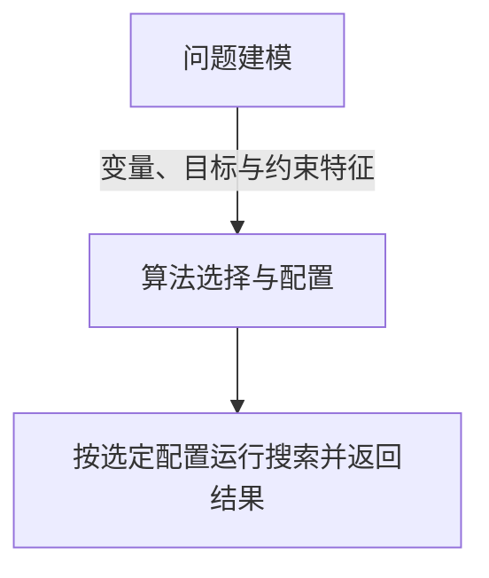

AutoCO（Automated Combinatorial Optimization，自动化组合优化）包括**问题建模**和**算法选择与配置**两个阶段。第一阶段根据问题描述与实例数据定义决策变量、目标函数和约束，并生成候选解求值函数。第二阶段根据模型特征从 12 类算法中选择搜索算法，配置算子和参数。平台随后执行选定配置，返回解及其可行状态。

## 什么时候使用 AutoCO

| 任务 | 可以查看的搜索结果 |
|---|---|
| 权衡电费与故障风险等相互冲突的目标 | 本次搜索找到的一组可行非支配方案 |
| 分配任务、安排工序或规划路线 | 在给定时间内找到的最佳可行分配或顺序 |
| 优化黑盒、分段或非线性目标 | 通过直接计算目标函数得到评分的候选方案 |

对于需要最优性证明且规模可处理的线性或混合整数线性规划，可以选择 Direct、TriVAL 等精确建模方法和相应求解器。在[优化对话](../chat-agent/)中，默认的「自动求解」可将多目标或启发式搜索请求交给 AutoCO。也可以在输入框底部或[运行设置](../run-settings/)中手动指定 `AutoCO`。

## 从问题描述到搜索配置

以 12 个任务分配到 4 个 GPU 集群为例。电费和故障风险是两个需要同时最小化的目标，集群容量和任务互斥则是必须满足的约束。下面可以逐步查看这些要求如何影响建模和搜索。



```walkthrough
[
  {
    "title": "问题建模",
    "nodes": [
      "Model"
    ],
    "body": "在此例中，决策变量是 12 个任务各自所属的集群，两个目标分别是电费和风险。求值函数对给定指派计算这两个目标及约束违反量。",
    "artifact": "P：集群容量和任务数据\nX：每个任务 j 的分配 x[j] ∈ {0, 1, 2, 3}\nF：最小化电费和故障风险\nC：容量不超限，互斥任务分属不同集群\n变量块：VarSpec('cluster', 'assignment', size=12, n_categories=4)\n评估输出：([电费, 风险], 约束违反量)\n可行分配的违反量为零。"
  },
  {
    "title": "算法选择与配置",
    "nodes": [
      "Config"
    ],
    "body": "根据指派变量与双目标的特征，选择能够保留多种权衡方案的算法，并配置种群规模和变异算子。可在本例上短时试运行候选配置，再执行选定的算法。",
    "artifact": "候选算法：NSGA-II、MOEA/D\nNSGA-II 可用的变异操作示例：交换两个任务的集群编号\n可配置的超参数包括种群规模和变异率。"
  },
  {
    "title": "查看求解结果",
    "nodes": [
      "Out"
    ],
    "body": "平台运行选定配置。每个可行指派方案都对应一组目标值，可据此比较不同方案的电费和风险。",
    "artifact": "每个返回点都对应一个分配方案的电费和风险。\n选中该点可查看各任务对应的集群。"
  }
]
```

## 如何选择和配置算法

AutoCO 将模型特征与沙箱检查结果结合起来，获得变量类型、目标数和单次评估耗时等信息。知识图谱记录问题特征与搜索机制的关系。例如，反转一段工序可能破坏先后约束，选配时可以查找只移动一道工序、保留其余工序相对次序的算子。

算法规格列出每种算法支持的算子和超参数。当 `enable_pilot` 开启且求解时限至少为 5 秒时，AutoCO 可以在每次试运行中测试一至两套配置，再确定正式搜索配置。试运行记录包括是否找到了可行解、可用的目标值及每秒评估次数。

| 搜索方式 | 内置算法 |
|---|---|
| 轨迹与邻域搜索 | SA、TS、ILS、LNS |
| 群体搜索 | GA、CMA-ES、DE、PSO、ACO |
| 多目标搜索 | NSGA-II、MOEA/D、NSGA-III |

## 查看和比较结果

单目标问题可以查看预算内找到的最佳可行解。对于多目标问题，工作台绘制本次返回的非支配方案并标出推荐折中解（Knee Point）。点击散点或表格行即可查看对应的决策明细，也可以在对话中讨论本次运行或导出结果。

结果反映提交的模型和本次实际搜索过的候选解。如果搜索结束时仍未找到可行解，模型是否可行仍待确定。使用 AutoCO 无需商业求解器许可证或单独选择建模库。在[方法对比](../method-comparison/)中，可将 AutoCO 与 Direct、TriVAL 等方法用于同一任务并排比较。
