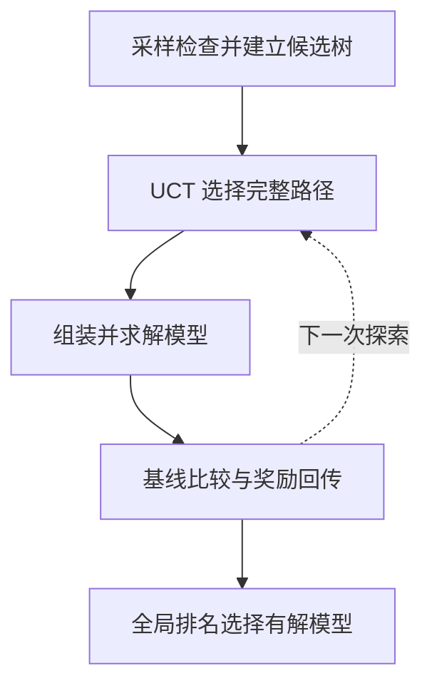

AutoFormulation 不只生成一个模型。它把模型拆成组件候选树，检查、去重和排序候选，再用蒙特卡洛树搜索（MCTS）探索完整模型，最终根据两两比较选择有解候选。

## 搜索的对象是什么

树的层次依次是参数、决策变量、目标、等式约束和不等式约束。一条从根到叶的路径构成完整数学模型。例如，同一个生产题可能出现“整数产量”和“连续产量”两种变量候选，后续组件都依赖这个选择。

完整候选由组件路径组成，每条路径都有独立的模型、代码与求解记录。候选比较使用模型判断，排名结果继续指导搜索。

## 建树、搜索与排名



```walkthrough
[
  {"title":"生成候选","nodes":["Sample"],"body":"相同含义的不同写法应去重，错误或无法构建的组件应被检查。等价表达合并后再扩展候选树。","artifact":"变量候选一：A、B 为非负整数\n变量候选二：x[p] 为非负整数，p∈{A,B}\n两者可能只是符号与索引形式不同。"},
  {"title":"选择路径","nodes":["Select","Solve"],"body":"UCT 在已有高分路径与探索不足路径之间分配搜索。被选路径要组装并实际求解后才能成为有解候选。","artifact":"路径：参数 → 变量 → 目标 → 等式 → 不等式\n每个完整候选都关联自己的代码和求解结果。"},
  {"title":"建立比较","nodes":["Compare"],"body":"前 3 个有解模型作为基线，奖励为 0.5。之后候选与基线双向比较，用判断胜率回传奖励。","artifact":"每个候选与基线进行双向比较。\n比较胜率作为搜索奖励回传。"},
  {"title":"选择最终模型","nodes":["Final"],"body":"Bradley–Terry 全局排名用于最终选择。排名来自模型判断；读者仍要核对整数域和关键业务规则。","artifact":"输出：所选候选的公式、代码与实际求解结果。\n过程记录保留候选路径、排名与执行产物。"}
]
```

## 去重与奖励怎样产生

参数候选按众数处理，决策变量通过多次大模型分组判断等价，其他表达使用 SymPy/Z3 等符号脚本辅助判断。可执行性检查与等价判断都在沙箱运行，不在宿主进程执行生成代码。

UCT 使用探索权重 `w_exp=1` 和节点自身奖励权重 `lambda_cte=0.5`。两两比较每方向使用多个判断，以减少单次次序和回复的影响。这些判断汇成候选之间的相对偏好。

## 预算为什么明显更大

默认每节点采样 8 个回答、保留 3 个候选，组件排名使用 5 个回答，执行 16 次 rollout。最初建树最多约 540 个回答，后续一次比较最多需要约 30 个回答；实际剪枝会减少用量。

默认独立运行预算可达 20,000 次模型调用、1,000 次求解和 6 小时。开始前先核对部署的用量限制。管理员可在部署预设中调整采样数与搜索预算。

## 什么情况下值得用

适合 LP/MILP 的候选建模与搜索研究，尤其是想观察模型结构选择如何影响结果时。清楚的单位、索引和字段说明仍很重要，它们能减少无意义候选。如果只需要先拿到一个可核对模型，用 [Direct](../direct/) 或 [Feedback Repair](../feedback-repair/) 更容易控制调用规模。

## 来源与平台适配

基于 [AutoFormulator 固定提交](https://github.com/jumpynitro/AutoFormulator/tree/52148018d04de23dc2d36d4281eb6244c2a42ffc)和 [ICML 2025 论文](https://proceedings.mlr.press/v267/astorga25a.html)。平台保留建树、MCTS 和排名流程，接入共享库代码与沙箱，限制无法解析的比较重试，并修正上游两候选比较方向相反的问题。完整差异在原始文档中列出。
