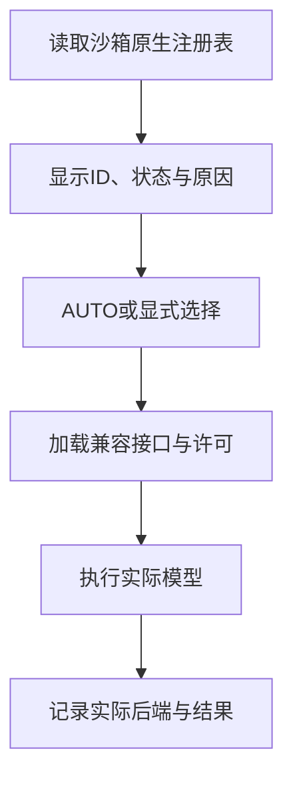

后端是实际执行数学计算的引擎。运行设置从求解环境的原生注册表列出后端ID、可用状态和原因，结果记录最终使用的引擎。

## 常见引擎与任务

| 引擎 | 常见模型方向 | 平台中的入口示例 |
|---|---|---|
| HiGHS、CBC、GLPK | 各自支持的LP/MIP | Pyomo、PuLP等兼容接口 |
| SCIP | 线性、整数，原生非线性约束 | PySCIPOpt、OR-Tools等 |
| CP-SAT | 有限整数、布尔、排程 | OR-Tools、CPMpy |
| Gurobi、COPT | 原生数学规划 | gurobipy、coptpy及兼容接口 |
| OSQP | 连续凸二次目标与线性约束 | CVXPY |
| Clarabel、SCS | 连续锥模型 | CVXPY |
| MOSEK | 对应原生能力与兼容模型 | CVXPY等支持接口 |
| Ipopt | 光滑连续NLP | CasADi等 |
| Bonmin | 兼容混合整数非线性模型 | CasADi插件 |
| SAT、SMT、MiniZinc等 | 有限域与逻辑 | CPMpy原生后端 |

准确ID从当前设置中选择。同一引擎通过不同库可能有不同原生标识，如PuLP的命令行与Python接口分别列出。

## 发现、选择与执行



AUTO 采用所选库与返回模型的原生逻辑；CVXPY使用兼容的已安装求解路径。显式选择用于固定引擎，运行错误提供具体的接口、依赖或许可信息。

## 安装或更新之后

Compose构建Worker镜像时安装后端依赖。本地Python方式可执行 `uv run llm4om build-worker`。自定义后端依赖时更新Worker环境，然后重新构建并重启服务。

后端目录在服务进程中缓存，依赖或许可变化后重启会重新发现。可先运行该库文章中的完整小模型，确认模型对象、接口与计算路径。

## 商业许可证配置

| 引擎 | 环境变量 | 示例文件 |
|---|---|---|
| Gurobi | `GRB_LICENSE_FILE` | `/opt/gurobi/gurobi.lic` |
| MOSEK | `MOSEKLM_LICENSE_FILE` | `/opt/mosek/mosek.lic` |
| COPT | `COPT_LICENSE_DIR` | 目录内的 `license.dat`、`license.key` |

在宿主机准备适用于容器、可离线使用的许可，使用相同绝对路径挂载进app。示例 `compose.override.yaml`：

```yaml
services:
  app:
    volumes:
      - /opt/gurobi/gurobi.lic:/opt/gurobi/gurobi.lic:ro
      - /opt/mosek/mosek.lic:/opt/mosek/mosek.lic:ro
      - /opt/copt/license.dat:/opt/copt/license.dat:ro
      - /opt/copt/license.key:/opt/copt/license.key:ro
```

在 `.env` 设置实际使用的对应变量，再执行 `docker compose up -d app`。Worker按这些文件创建只读挂载。保留所需引擎的条目即可。

## 根据错误定位环境问题

| 错误内容 | 检查位置 |
|---|---|
| 找不到可执行程序 | Worker内命令行求解器安装与PATH |
| 插件无法加载 | 原生库、驱动和依赖 |
| 许可文件或主机不匹配 | 文件路径、容器适用性与许可内容 |
| 模型类型不支持 | 变量域、表达式与后端能力 |
| 模型规模触发限制 | 使用的许可与目标模型规模 |

将完整错误与实际后端一起保存在运行记录中，便于复查。常用问题见[排查指南](../troubleshooting/)。

## 原生配置资料

配置细节见 [Gurobi文档](https://docs.gurobi.com/projects/optimizer/en/current/)、[MOSEK客户端配置](https://docs.mosek.com/latest/licensing/client-setup.html)和 [COPT安装与许可](https://guide.coap.online/copt/en-doc/install.html)。接口与数学类型见[求解器总览](../solvers/)。
