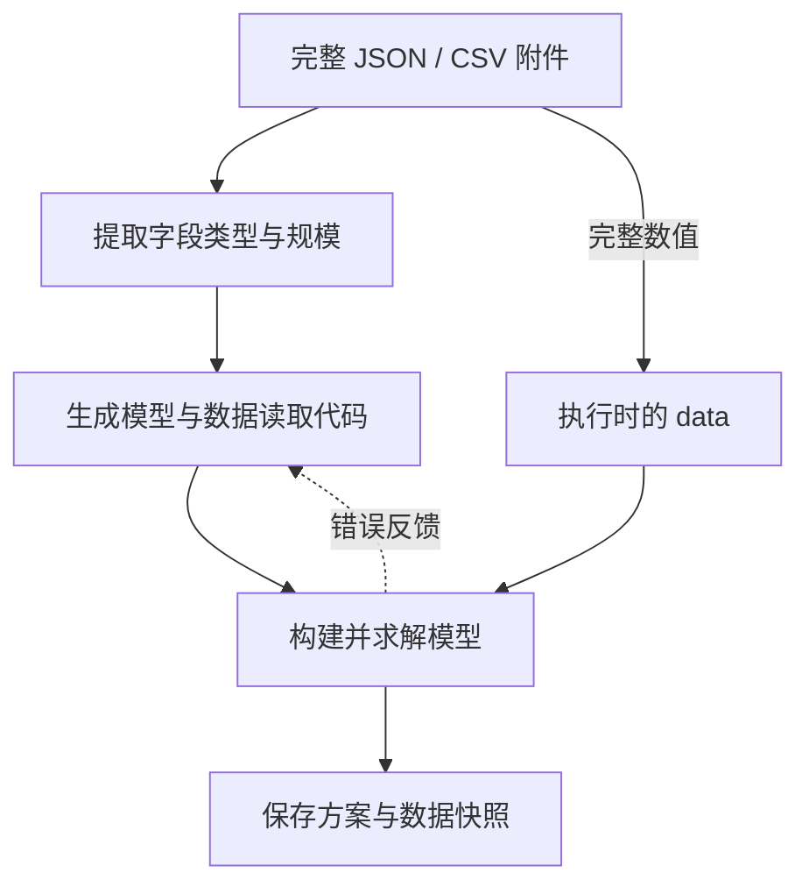

BIND 把“理解数据结构”和“读取完整数值”分开：大模型看到字段、类型和规模，生成代码在执行时读取完整 JSON/CSV。它针对附件预览截断、长表抄写和数据绑定错误。

## 为什么只给结构也能建模

许多优化模型的结构不依赖每一个具体数值。运输模型需要知道运费是仓库×门店矩阵，需求是按门店索引的数组；不必把矩阵中每个数字复制进提示，再让模型抄回代码。

在题面中说明字段含义，例如 capacity 的单位、矩阵的行列对象以及需求的索引。

## 数据怎样流动



```walkthrough
[
  {"title":"准备数据","nodes":["File"],"body":"上传结构化文件，同时在题面写清每个字段的单位和索引含义。","artifact":"production.json\nprofit: 按产品索引的单件利润\nusage: 资源×产品的小时/件矩阵\ncapacity: 每种资源可用小时"},
  {"title":"提供结构","nodes":["Schema","LLM"],"body":"模型读取结构描述，不把完整数值表展开到生成提示。嵌套与非矩形结构应如实保留。","artifact":"profit: array[number], length 2\nusage: array[array[number]], 2 rows\ncapacity: array[number], length 2"},
  {"title":"执行绑定","nodes":["Data","Solve"],"body":"代码通过 data 中的文件文本解析全部数据，并据此构建目标和约束。","artifact":"payload = json.loads(data['production.json'])\nprofit = payload['profit']\nusage = payload['usage']\ncapacity = payload['capacity']"},
  {"title":"核对与修复","nodes":["Finish"],"body":"格式或执行错误可反馈重试。真实不可行按有效求解状态保存。","artifact":"最多 3 次生成/执行尝试。\n检查行列含义和单位，不只检查文件是否成功解析。"}
]
```

## 一个可直接使用的数据样例

```json
{
  "products": ["A", "B"],
  "profit": [3, 2],
  "usage": [[2, 1], [1, 2]],
  "capacity": [8, 8]
}
```

配套题面可写：“`usage[r][p]` 是生产一件产品 p 占用资源 r 的工时。`capacity[r]` 是可用工时。决定非负整数产量，最大化总利润，不得超过任何资源容量。”正确结果为 A=3、B=2、利润13。改变数值前，可先在[数据编辑示例](../attachments/)观察保存与结果快照的关系。

## 支持的输入与信息范围

当前支持 JSON 和 CSV；Excel 由前端转换成 CSV 后使用。CSV 表头与行宽在调用模型前检查；JSON schema 按实际嵌套和元素类型描述。没有附件时，直接使用题面生成模型。

数据路径分为生成输入与执行反馈：生成阶段提供 schema，执行阶段读取完整附件；后续反馈可以包含实际目标值和变量值。

## 何时使用与怎样检查

适合规则相对明确、数据量大于方便人工抄写规模的结构化问题。检查代码是否读取正确文件、字段、行列，以及是否遍历完整记录。若目标是复核复杂规则的语义，结合 [Feedback Repair](../feedback-repair/) 或 [TriVAL](../trival/) 的流程比较更有意义。

## 来源与平台适配

基于 [Text2Opt-Bench 固定提交](https://github.com/SprocketLab/Text2Opt-Bench/tree/1dac06be656c41d827ef20987cf8af0b48d382a2)的 schema offload 和默认 agentic 路径。平台使用用户附件，去掉基准参考最优值和模型规模评分依赖，输出公式与原生模型代码，按真实执行状态决定修复。
