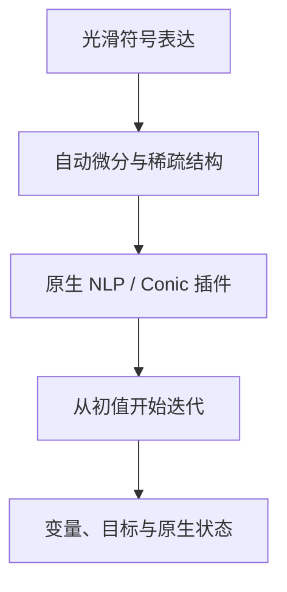

CasADi 用符号表达和自动微分构建优化问题。Opti 提供便于组织变量、目标和约束的接口，常用 Ipopt 处理光滑连续非线性模型。

## 一个完整的非线性模型

下面的单变量函数有两个谷底，可用于观察初始点与局部求解结果的关系：

$$\min_{-2\le x\le2}\;(x^2-1)^2+0.2x.$$

```python
import casadi as ca

def build_model(data):
    model = ca.Opti()
    x = model.variable()
    model.minimize((x*x - 1)**2 + 0.2*x)
    model.subject_to(model.bounded(-2, x, 2))
    model.set_initial(x, -1.8)
    return model
```

选择 CasADi 和 Ipopt。模型中的初值、边界和光滑表达会进入求解；结果变量使用 CasADi 原生命名，公式中应说明各分量含义。

## 播放一个局部搜索示例

```demo
local
```

这个交互用固定步长梯度下降展示函数上的迭代。选择不同起点，查看路径、迭代次数与目标值。正式 CasADi 运行使用你在平台选择的原生插件。

## 符号问题怎样求解



Opti NLP 常用 Ipopt；Opti Conic 可指定兼容插件，如 qrqp。整数变量使用 `set_domain` 并配合 Bonmin 等兼容插件。可用插件来自执行环境的原生注册表。

## 最大化与低层接口

最大化 f 时用最小化 `-f`，并返回目标符号，使结果恢复为业务目标：

```python
return {"model": model, "objective_sign": -1}
```

低层 `nlpsol/qpsol/conic` 通过字典提供 `problem`、`arguments`，以及可选 `solver` 和 `options`。原生向量结果按 `x[i]` 顺序保存，适合明确控制数值参数、稀疏结构与插件配置的工作流。

## 使用结果与继续计算

非凸 NLP 结果保留局部求解状态。可以把不同初值、边界或业务条件作为独立场景运行，比较实际变量与目标，并在过程页查看每次配置。

CasADi 适合光滑非线性连续模型、控制与轨迹类表达。凸二次与锥模型也可了解 [CVXPY](../cvxpy/)，离散组合结构可查看 [OR-Tools](../ortools/)。更多接口见 [CasADi 文档](https://web.casadi.org/docs/)和[插件 API](https://web.casadi.org/python-api/)。
