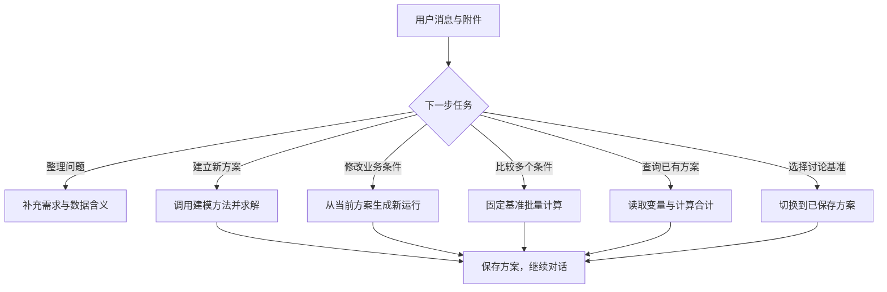

Chat Agent 的入口是侧栏“优化对话”。你可以从一个想法开始，逐步补充数据、计算方案，再围绕同一任务继续提问和调整。

## 从第一条消息开始

打开“优化对话”，选择模型预设，直接输入要解决的问题。可在消息旁添加 CSV、JSON 或 Excel。默认建模偏好是 Direct、Pyomo 和 AUTO；输入框旁可以固定方法与建模库，也可以在消息中指定。

```text
我们要安排下周的门店排班。每天至少3人，每人最多工作5天。
周末每个班次都要有主管。请先根据附件检查还缺哪些信息，
确认后计算用工成本最低的安排。
```

助手根据当前信息组织回复，工具执行时显示建模阶段与方案卡片。电脑端旁边的工作区可查看模型、代码和结果；点击方案入口可打开完整运行页并导出。

## 一次对话怎样推进



## 试一次方案对话

下面从收益13的生产方案开始，可以依次查询资源使用、增加最低产量、比较场景、回到原方案。每个按钮对应一种对话操作。

```demo
plans
```

在真实工作台中，可以直接发送这些消息：

| 想做什么 | 消息示例 | 得到什么 |
|---|---|---|
| 查看具体决策 | “列出周二上班的员工及其费用。” | 从保存结果查询变量 |
| 算派生指标 | “合计这份方案的周末成本。” | 计算卡片、表达式与实际值 |
| 调整一个条件 | “周二至少4人，其他不变，重新计算。” | 新方案与完整运行记录 |
| 同时比较条件 | “分别计算预算1000和1200的方案。” | 共同基准下的多个场景 |
| 选择后续基准 | “接下来使用第二个方案。” | 当前讨论方案选择回执 |

## Agent 使用哪些工具

| 工具 | 在对话中的作用 |
|---|---|
| `modeling_capabilities` | 查询当前方法、问题范围、建模库与实际后端可用状态 |
| `model_and_solve` | 把明确问题交给完整建模方法，保存新运行 |
| `solve_scenarios` | 从固定方案整理并计算多个变更场景 |
| `lookup_variables` | 按名称、分组和分页读取完整变量值 |
| `calculate` | 使用已读取数值计算费用、比例或资源合计 |
| `select_plan` | 将已保存方案选为后续对话基准 |

一次对话轮次通过一个方案变更工具推进计算；多个明确条件可通过场景工具一并提交。变量查询和数值计算可配合使用。

## 当前方案、浏览与附件

一次新增方案完成后，它成为后续讨论的当前方案。多个场景从同一基准分别计算，当前基准保持原选择。工作区标明“当前讨论方案”和“正在查看历史方案”，可随时返回讨论中的方案。

附件点击文件名即可编辑。保存后，在消息中要求按新数据重新建模；新运行保存新附件，已有方案保留原输入快照。联网搜索开启后可展开来源，确认采用的业务规则后继续计算。

## 日常操作与恢复

Enter 发送，Shift+Enter 换行。拖动分隔线调整对话和建模区宽度，也可用 Tab 聚焦分隔线后按方向键。上翻阅读时暂停跟随，点击“回到最新消息”继续跟随。

刷新会连接服务器上的活动运行。已保存的方案可从卡片或历史打开；停止与重试入口保留本轮上下文。DeepSeek 的“深度思考”开关控制当前对话回复，工具中的建模使用运行预设参数。
