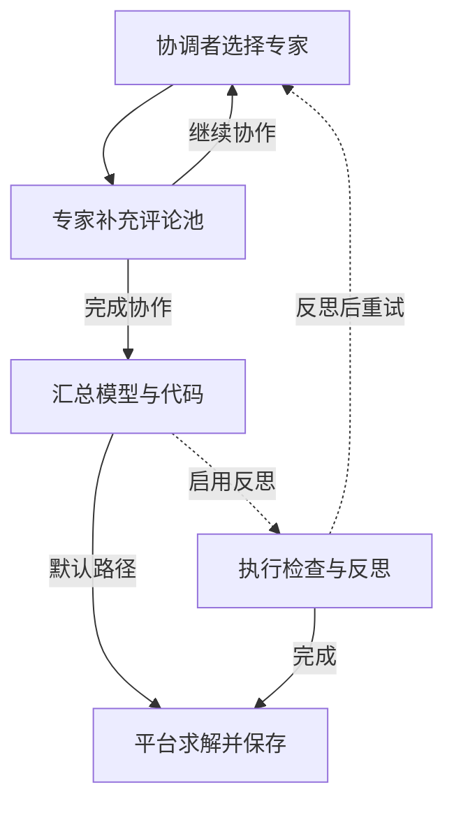

Chain-of-Experts（CoE）让协调者按顺序选择专家，后来的专家读取已有意见，最后由汇总器写出模型和代码。每位专家的意见会加入评论池，供后续角色读取。

## 专家意见如何影响下一步

协调者从七类角色中选择下一位专家。每位专家看到题目和当前评论池，因此后续意见可以针对前面的判断补充或纠正。默认每轮选择三位专家，随后汇总。

每个专家角色使用专属提示和当前评论池，调用本次运行选择的模型预设。

## 流程与协作案例



```walkthrough
[
  {"title":"解释问题","nodes":["Conductor","Expert"],"body":"这组示例展示专家意见怎样进入评论池，第一步先解释业务术语。","artifact":"示意意见：单件利润不同于销售额；每件工时不同于总工时。"},
  {"title":"补充建模意见","nodes":["Expert"],"body":"后续专家读取已有意见，补充变量域、索引和资源约束。","artifact":"示意意见：产量按整件计，使用非负整数。\n切割：2A+B≤8；装配：A+2B≤8。"},
  {"title":"汇总","nodes":["Reduce"],"body":"汇总器必须把评论变成一份内部一致的模型和代码。意见之间若有冲突，最终代码仍需明确选择。","artifact":"汇总产物：变量域、目标、资源约束与完整代码。\n每条关键意见可对应到最终表达。"},
  {"title":"理解默认路径","nodes":["Reflect","Return"],"body":"默认路径完成三位专家协作与汇总，随后由平台实际求解。","artifact":"默认：三位专家 → 汇总 → 平台求解\n执行反思是部署预设控制的可选分支。"}
]
```

## 反思分支的实际含义

启用反思后，仅代码执行失败触发归因。从最后发言的专家向前询问，找到承认责任的角色后修订意见。每次新试验会清空评论池。

默认 `enable_reflection=false`；`max_trials=3` 只在反思开启时约束多轮试验。执行检查以代码能否取得求解状态为依据。

## 阅读与比较建议

关注专家是否增加了新信息：是否发现遗漏约束、解释了歧义、或指出目标与变量域的问题。最终模型和代码显示这些意见如何进入实际计算。

它适用于 LP/MILP 的协作建模展示和方法比较。若需要针对一条约束给出可追踪的验证判定，参看 [SAC-Opt](../sac-opt/)；若需要按类型检索模板，参看 [OptiTree](../optitree/)。

## 来源与平台适配

来自 [Chain-of-Experts 固定提交](https://github.com/xzymustbexzy/Chain-of-Experts/tree/afb89bf602690ea621f13a23c42722f20f653a43)，保留协调者、七类专家和汇总器提示。平台把原始代码示例替换为所选库的完整契约，执行检查使用真实附件和沙箱，不让模型另造测试输入。
