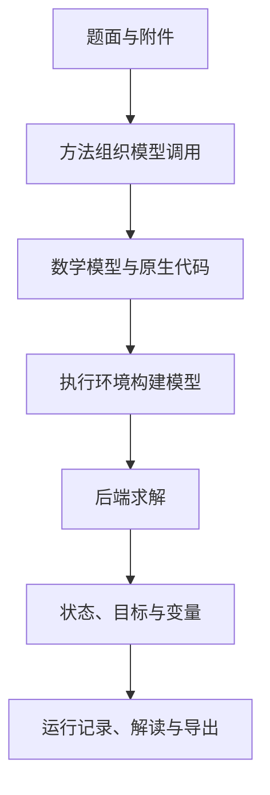

LLM4OM 把需求、建模、计算和方案管理连接起来。下面的术语对应界面中的具体设置和产物，方便你在文档与工作台之间切换。

## 一次运行的数据流

附件通过文件名映射到完整文本；模型代码在 `build_model(data)` 中解析数据并返回原生模型。平台负责执行和结果保存。

## 四个配置对象

| 名称 | 具体作用 | 例子 |
|---|---|---|
| 建模方法 | 编排生成、检查和修复 | Direct、TriVAL、BIND |
| 模型预设 | 保存模型服务与请求配置 | 团队的服务地址和模型ID |
| 建模库 | 表达变量、目标与约束 | Pyomo、CPMpy、CVXPY |
| 后端 | 执行数学计算 | HiGHS、CP-SAT、Gurobi、Ipopt |

一份配置可写成“Feedback Repair + 团队模型 + Pyomo + HiGHS”。运行信息保存这组选择与实际后端。

## 模型中的四类信息

| 信息 | 含义 | 生产案例 |
|---|---|---|
| 参数 | 输入中已知的数值 | 单件利润、资源容量 |
| 变量 | 需要决定的数值或选择 | A、B的产量 |
| 目标 | 要最小化或最大化的表达 | 总利润 |
| 约束 | 决策需要满足的关系 | 工时容量与最低订单 |

索引把这些信息扩展到多个产品、日期、员工或节点。业务单位在题面、数据和结果标签中贯穿保存。

## 运行与方案

运行记录包含输入、配置、步骤、公式、代码和求解。方案指其中的实际决策结果。一次调整生成新运行；场景对比把多个运行与同一基准关联；对话中的“当前方案”决定后续提问和调整从哪里开始。

## 常见状态

| 状态 | 读取方式 |
|---|---|
| optimal | 当前模型得到最优结果 |
| feasible | 已有可行方案 |
| locally_optimal | 原生非线性路径得到局部结果 |
| infeasible | 当前模型的要求无法共同满足 |
| unbounded | 目标沿可行方向无界 |
| time_limit | 到达时限，继续查看已保存解与反馈 |
| 执行或验证失败 | 在过程页读取失败阶段和具体信息 |

状态、变量和方法验证反馈都保存在运行中。日常使用见[结果指南](../results/)，具体算法和接口见[方法](../methods/)与[求解器](../solvers/)。
