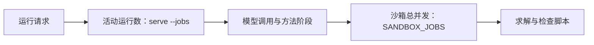

配置决定默认模型、运行并发、用量额度和数据保存。Compose使用 `.env` 与数据卷，Python启动使用环境变量和 `--workspace`。

## 模型与搜索配置

| 字段 | 作用 |
|---|---|
| `LLM4OM_LLM_PROVIDER` | 默认模型服务商 |
| `LLM4OM_LLM_BASE_URL` | 服务地址 |
| `LLM4OM_LLM_MODEL` | 实际模型ID |
| `LLM4OM_LLM_API_KEY` | 模型服务密钥 |
| `LLM4OM_LLM_NAME` | 预设显示名称 |
| `LLM4OM_LLM_EXTRA_BODY` | 服务商额外JSON参数 |
| `LLM4OM_SEARCH_API_KEY` | 独立搜索服务密钥 |
| `LLM4OM_SEARCH_BASE_URL` | 搜索服务地址 |

DeepSeek预设可使用自己的搜索配置；其他模型使用独立搜索密钥。字段示例和预设操作见[模型配置](../model-presets/)。

## 设置共享用量

```dotenv
LLM4OM_DAILY_TOKENS=2000000
LLM4OM_RUNS_PER_HOUR=30
LLM4OM_SANDBOX_JOBS=4
TZ=Asia/Shanghai
LLM4OM_TRUST_PROXY=1
```

每日额度按每个预设的输入加输出token累计；每小时运行额度按客户端地址计算。值为0或未设置时采用无上限配置。`TZ=Asia/Shanghai`将每日换日设为北京时间零点。

预设窗口显示当天用量。每日额度达到上限后，下一次模型调用显示额度提示，可选择其他可用预设或次日继续。已经保存的计算结果可继续查看。

## 运行与沙箱的两层并发



`serve --jobs` 默认4，其他运行排队。沙箱并发默认4，覆盖所有运行以及AutoFormulation的并行检查；等待沙箱计入运行时限。每个工作区由一个服务进程管理。

## 备份完整工作区

Compose数据卷保存预设、密钥、历史和运行。先停止app，使保存完成，再复制：

```bash
docker compose stop app
docker compose cp app:/data ./llm4om-backup
chmod -R go-rwx ./llm4om-backup
docker compose start app
```

将备份保存在有访问控制的位置。Python服务备份指定的 `--workspace` 目录。

## 恢复与迁移

```bash
docker compose stop app
docker compose cp ./llm4om-backup/. app:/data/
docker compose start app
```

迁移已有Python工作区时，用 `runs/web/.` 或实际工作区替换备份路径。启动后检查预设和一条历史运行，确认记录与附件可读取。

服务每10秒与正常退出时落盘，先写临时文件再改名。日常停止采用正常停止命令，可使当前公开步骤与中间产物保存完成。

## 可选调用追踪

需要外部调用追踪时配置 `LANGSMITH_TRACING`、`LANGSMITH_API_KEY` 与 `LANGSMITH_PROJECT`。开启后，问题、数据与模型回答发送至LangSmith。平台工作区同时保留本地运行记录。

更多字段见仓库[环境变量示例](https://github.com/Fangziyang0910/LLM4OM/blob/main/.env.example)，服务入口与HTTPS见[团队部署](../team-deployment/)。
