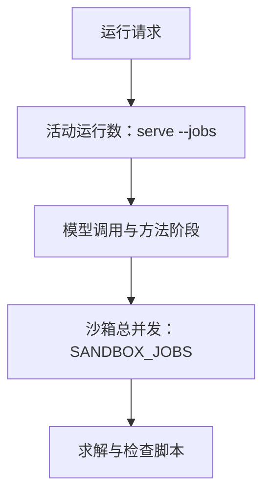

配置决定默认模型、运行并发、用量额度和数据保存。Compose使用 `.env` 与数据卷，Python启动使用环境变量和 `--workspace`。

## 选择配置位置

| 要改变的内容 | 修改位置 | 如何确认生效 |
|---|---|---|
| 页面可选的模型与密钥 | AI 模型设置 | 保存并选择该预设，用快速开始的小题测试 |
| 服务器默认模型 | `.env` 或服务进程的环境变量 | 重启 Python 服务；Compose 更新环境后重新创建 app，检查默认预设 |
| 运行和沙箱并发、额度 | 启动参数与环境变量 | 重启或重新创建服务后检查启动配置与预设用量 |
| 中文或英文显示 | 浏览器“外观与语言” | 切换后发起新运行；历史内容使用阅读译文，不改写原记录 |

修改 `.env` 不会自动改变已经运行的进程。页面添加的预设保存在当前工作区；切换 `--workspace` 后不要把“找不到原预设”误判为密钥丢失。

## 模型与搜索配置

| 字段 | 作用 |
|---|---|
| `LLM4OM_LLM_PROVIDER` | 默认模型服务商 |
| `LLM4OM_LLM_BASE_URL` | 服务地址 |
| `LLM4OM_LLM_MODEL` | 实际模型ID |
| `LLM4OM_LLM_API_KEY` | 模型服务密钥 |
| `LLM4OM_LLM_NAME` | 预设显示名称 |
| `LLM4OM_LLM_EXTRA_BODY` | 服务商额外JSON参数 |
| `LLM4OM_SEARCH_API_KEY` | 独立搜索服务密钥 |
| `LLM4OM_SEARCH_BASE_URL` | 搜索服务地址 |

DeepSeek预设可使用自己的搜索配置；其他模型使用独立搜索密钥。字段示例和预设操作见[模型配置](../model-presets/)。

## 设置共享用量

```dotenv
LLM4OM_DAILY_TOKENS=2000000
LLM4OM_RUNS_PER_HOUR=30
LLM4OM_SANDBOX_JOBS=4
TZ=Asia/Shanghai
```

每日额度按每个预设的输入加输出 token 累计；每小时运行额度按客户端地址计算。这两项额度为 0 或未设置时不限制。沙箱并发仍默认 4，必须大于 0，不能用 0 表示无限并发。

每日换日使用服务进程的本地日期。Linux / Compose 环境可配置 `TZ=Asia/Shanghai`；Windows 本地服务应核对系统时区，不要假定设置 `TZ` 就会改变进程日期。

只有部署在可信反向代理之后时才设置 `LLM4OM_TRUST_PROXY=1`；它使运行限流读取转发地址。直接暴露服务时保持默认值，避免信任客户端自行提供的转发头。

预设窗口显示当天用量。每日额度达到上限后，下一次模型调用显示额度提示，可选择其他可用预设或次日继续。最后一次调用可能超过额度，因为费用在调用结束后计入；阅读译文和题库翻译也计入实际调用预设的额度。已经保存的计算结果可继续查看。

## 运行与沙箱的两层并发



`serve --jobs` 默认4，其他运行排队。沙箱并发默认4，覆盖所有运行以及AutoFormulation的并行检查；等待沙箱计入运行时限。每个工作区由一个服务进程管理。

## 备份完整工作区

Compose数据卷保存预设、密钥、历史和运行。先停止app，使保存完成，再复制：

```bash
docker compose stop app
docker compose cp app:/data ./llm4om-backup
chmod -R go-rwx ./llm4om-backup
docker compose start app
```

将备份保存在有访问控制的位置。Python服务备份指定的 `--workspace` 目录。

以上权限命令适用于 Linux shell；Windows 备份应使用文件夹的访问权限限制读取。备份含预设密钥和私有译文缓存，不能放入 Git 或公开分享。恢复前保留目标工作区的独立备份，确认没有其他服务进程正在写入该目录。

## 恢复与迁移

```bash
docker compose stop app
docker compose cp ./llm4om-backup/. app:/data/
docker compose start app
```

迁移已有Python工作区时，用 `runs/web/.` 或实际工作区替换备份路径。启动后检查预设和一条历史运行，确认记录与附件可读取。

服务每10秒与正常退出时落盘，先写临时文件再改名。日常停止采用正常停止命令，可使当前公开步骤与中间产物保存完成。

## 可选调用追踪

需要外部调用追踪时配置 `LANGSMITH_TRACING`、`LANGSMITH_API_KEY` 与 `LANGSMITH_PROJECT`。开启后，问题、数据与模型回答发送至LangSmith。平台工作区同时保留本地运行记录。

更多字段见仓库[环境变量示例](https://github.com/Fangziyang0910/LLM4OM/blob/main/.env.example)，服务入口与HTTPS见[团队部署](../team-deployment/)。
