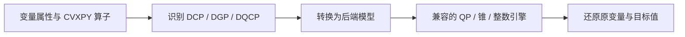

CVXPY 用结构化的数学表达建立凸优化和相关模型。平方损失、范数、线性变换和锥约束都有原生算子，适合拟合、资源分配、组合权重和带正则项的优化问题。

## 一个完整的凸二次案例

希望连续决策 `(x,y)` 尽量接近目标 `(1,2)`，同时总资源不超过2，两个量均非负：

$$\min_{x,y\ge0}(x-1)^2+(y-2)^2\quad\text{s.t.}\quad x+y\le2.$$

最优点为 `(0.5,1.5)`，目标值0.5。

```python
import cvxpy as cp

def build_model(data):
    x = cp.Variable(2, nonneg=True, name="allocation")
    objective = cp.Minimize(cp.sum_squares(x - [1.0, 2.0]))
    return cp.Problem(objective, [cp.sum(x) <= 2])
```

选择 CVXPY；此类连续凸二次目标、线性约束可选 OSQP。平台调用求解并读取变量数组，代码返回 `Problem`。

## 交互查看资源变化

```demo
convex
```

将资源从2调到3，最优点逐步接近目标。图中线段连接目标与当前解，椭圆表示以目标为中心的等目标值轮廓。结果中的变量分量按数组顺序对应 x、y。

## 从表达式到后端



DCP 描述有规则的凸表达；DGP 使用正变量和几何规划结构；DQCP 使用可识别的拟凸结构。平台从 Problem 识别模式，DGP 使用 `gp=True`，DQCP 使用 `qcp=True`。

## 怎样选后端

| 模型 | 常见后端方向 |
|---|---|
| 连续凸二次目标、线性约束 | OSQP |
| 支持的连续锥结构 | Clarabel、SCS 等 |
| 含整数或布尔决策 | 支持对应模型的混合整数后端 |
| 需要 MOSEK 原生能力 | MOSEK 与已配置许可 |

AUTO 使用兼容的已安装 `solver_path`，结果记录实际引擎。显式指定后端用于固定计算路径。安装与许可见[后端说明](../backends/)。

## 表达与使用

矩阵乘法用 `@`，求和用 `cp.sum`，范数用 `cp.norm`，二次型用 `cp.quad_form`。变量的 nonnegative、positive、integer 等属性帮助表达规则识别。将业务中的“开关”“选择”准确映射为相应变量域。

查看完整数值后，可在[方案对话](../plan-chat/)中计算实际组合成本或按新预算重算。更多算子和模式见 [CVXPY 求解文档](https://www.cvxpy.org/tutorial/solvers/)、[DGP](https://www.cvxpy.org/tutorial/dgp/)与 [DQCP](https://www.cvxpy.org/tutorial/dqcp/)。
