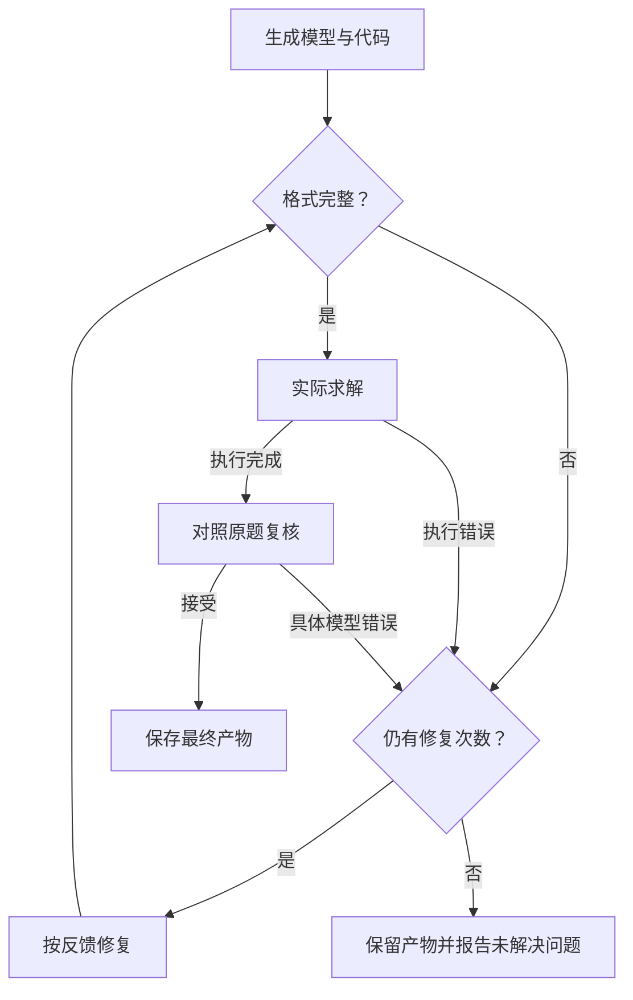

Feedback Repair 在 Direct 的一次生成之后加入实际求解、对照原题复核和定向修复。它关注一个常见问题：程序能运行、求解器也说最优，但模型可能把业务规则写错了。

## 为什么求解成功之后还要检查

如果题目要求 B 至少生产 3 件，而代码写成 `B <= 3`，生产案例仍会返回收益 13 的最优方案 `(3, 2)`。这个结果对错误模型是正确的，却违反原需求。只修复 Python 异常发现不了这种错误。

复核节点读取原题、数学模型、代码、执行反馈和可用冲突诊断，检查目标系数、变量域、约束方向和数据绑定。它应指出具体不一致，再决定接受或修复。

## 执行流程与逐步案例



```walkthrough
[
  {"title":"初次建模","nodes":["Generate","Solve"],"body":"假设这次生成把最低需求的方向写反。求解器不读取题意，因此仍可能报告最优。","artifact":"原要求：B ≥ 3\n假设误写：B ≤ 3\n错误模型最优：A = 3，B = 2，收益 13"},
  {"title":"对照复核","nodes":["Review"],"body":"检查者指出原题与代码的具体差别，并将其写入修复反馈。","artifact":"判断：repair\n原因：最低产量要求写成上限，B = 2 违反 B ≥ 3。"},
  {"title":"修复重算","nodes":["Budget","Repair","Solve"],"body":"改回 B ≥ 3，保留其他要求，再执行新代码。","artifact":"2A + B ≤ 8；A + 2B ≤ 8；B ≥ 3\n整数最优：A = 2，B = 3，收益 12"},
  {"title":"接受或报告","nodes":["Review","Finish","Failed"],"body":"收益下降是满足要求的代价。通过后结束；次数用尽仍有具体错误，则保留结果并报告失败。","artifact":"原方案收益 13；满足 B ≥ 3 后收益 12。\n两份模型与结果可分别查看。"}
]
```

## 应该修什么

| 反馈 | 合理处理 |
|---|---|
| 语法错误、返回对象不符合契约 | 按执行反馈修复代码 |
| 整件产品被写成连续变量 | 修复变量域并重算 |
| 真实需求与资源冲突 | 接受经复核的不可行结果并保留原要求 |
| 时间上限内只有可行解 | 保存当前状态与已有可行方案 |
| 满足性问题没有目标值 | 核对它是否本来只需满足约束 |

## 次数与最终产物

最多修复三次。格式、执行和建模修复共享同一个三次预算。无需修复时，方法使用两次大模型调用和一次求解；平台的方案解读可能另有调用。

后续回复不完整时，保留最后一次实际执行的模型、代码和结果。复核调用失败或回复无法解析，也保留已完成计算，并说明复核失败。

## 怎样使用与阅读过程

在运行设置选择 Feedback Repair。看第一次生成、复核理由和改动位置。每次修复都可以沿反馈理由找到对应规则和代码位置。

它适合用简短流程增加一次结果后核对的场景。分层验证见 [TriVAL](../trival/)；逐约束回译和冻结已通过组件见 [SAC-Opt](../sac-opt/)。

## 实现来源

由本项目维护，复用 Direct 的生成提示。复核节点和修复循环的实现与生成提示一并公开。
