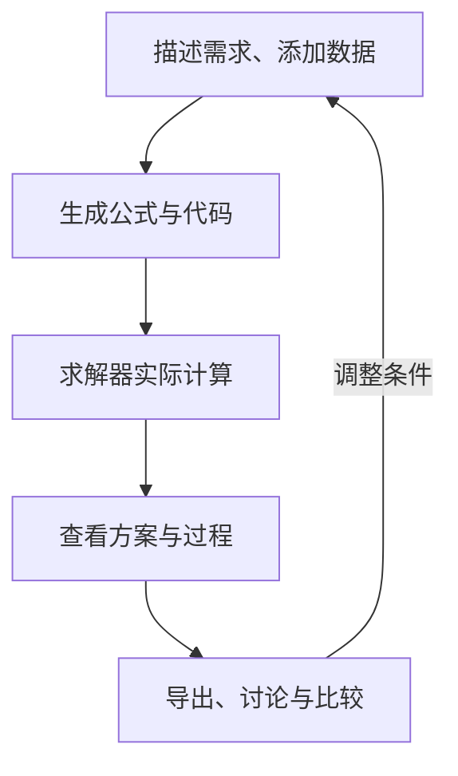

通用智能优化求解器（General Intelligent Optimization Solver）是自然语言驱动的**精确求解 × AutoCO 智能优化双引擎平台**。直接用日常语言描述业务目标与约束并拖入表格，系统自动在 **9 大精确数学建模框架**与 **AutoCO 12 类智能优化算法池**之间路由，在隔离沙箱内实算并返回可验证的最优解与多目标 Pareto 前沿。

## 选择你的使用入口

| 入口 | 适合怎样开始 | 接下来能做什么 |
|---|---|---|
| [优化对话](../chat-agent/)（工作台默认首页 `/`） | 直接发送问题或拖入 Excel/CSV | 零配置自动路由双引擎、实时联动 Pareto/方案解读、追问调整与多场景对比 |
| [多方案对比与手动建模](../run-settings/)（`/model`） | 已有明确题面，想指定方法或并行横评 | 自由切换 14 种建模策略、9 大建模库与求解器，一次并排跑最多 12 组对比 |
| [需求助手](../requirements/) | 业务想法仍在整理 | 形成结构化需求稿与附件，再一键交给求解引擎 |

第一次使用，按[快速开始](../quickstart/)完成一个生产案例；需要私有化部署，见[安装与启动](../installation/)。

## 从需求到可使用的方案

一次运行保存题面、附件、配置、公式、代码、实际变量和步骤。可以在同一任务中保留原方案与后续变更，查看每份结果的来历。

## 日常功能怎样配合

| 你想完成的事 | 文档入口 |
|---|---|
| 把表格带进问题，修改字段与数值 | [上传与编辑数据](../attachments/) |
| 看具体产量、排班或分配结果 | [查看与导出结果](../results/) |
| 查询某个决策、合计费用 | [讨论方案](../plan-chat/) |
| 改一项要求，得到新方案 | [调整条件](../revisions/) |
| 比较多个预算、需求或资源条件 | [业务场景](../scenarios/) |
| 查找旧任务，记录结论与分享 | [历史、标签与报告](../history/) |

## 理解平台怎样建模和计算

[建模方法](../methods/)介绍 **14 种策略**：包括三大核心精确工作流（Direct、Feedback Repair、TriVAL）、面向大规模组合与多目标权衡的 **[AutoCO 智能优化引擎](../autoco/)**，以及 10 种学术前沿方法。每篇均提供机制说明、Mermaid 流程图、可逐步点击的案例与当前参数。

[建模库与求解器](../solvers/)按数学结构介绍 **9 个精确建模库**（Pyomo、gurobipy、OR-Tools、CPMpy、PuLP、CVXPY、PySCIPOpt、CasADi、coptpy）、原生接口、后端选择与完整代码。

## 看实际操作，也可以动手尝试

文档包含对应语言的工作台录屏、截图和交互示例。快速开始可下载数据并跟随操作；方法文章可逐步查看输入、中间产物和反馈；求解器案例可改变参数并查看计算结果。

界面支持中文、英文及浅色、深色和跟随系统外观。桌面可拖动分隔线调整阅读区域，窄屏通过页签切换主要内容与助手。

## 团队与脚本工作流

[团队部署](../team-deployment/)介绍共享服务、HTTPS和访问配置；[用量与备份](../configuration/)介绍额度、并发和数据维护。需要接入已有程序，可使用[命令行与Python](../cli-python/)运行同一套建模流程。

通用智能优化求解器由 [EIPI团队](https://scut-eipi.github.io/)开发，源码与文档持续公开维护。
