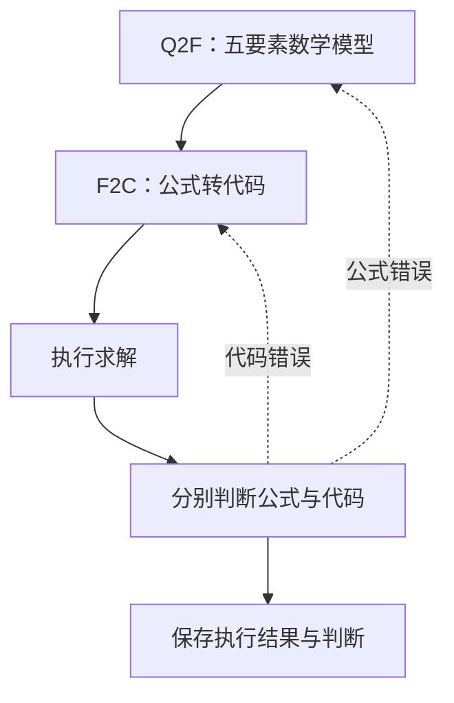

LLMOPT 用五要素模型连接自然语言和求解代码：集合、参数、变量、目标、约束。执行后，自我校正节点分别判断数学表达和代码，再返回相应阶段。

## 五要素怎样帮助定位错误

五要素把“有哪些对象”“哪些量已知”“决定什么”“追求什么”“必须满足什么”分开。索引、单位和变量域因此有明确位置，便于判断错误来自理解问题还是代码实现。

| 要素 | 生产案例 |
|---|---|
| Sets | 产品集合 P={A,B}，资源集合 R={切割,装配} |
| Parameters | 利润 p，单耗矩阵 a，容量 b |
| Variables | 每种产品的非负整数产量 x[p] |
| Objective | 最大化利润之和 |
| Constraints | 每种资源的总占用不超过容量 |

## 流程与分层修正案例



```walkthrough
[
  {"title":"写清结构","nodes":["Define"],"body":"五要素模型必须保留整件要求、资源维度和参数取值。F2C 主要依赖这份模型，前面遗漏的内容会传到代码。","artifact":"Sets: P, R\nParameters: profit[P], usage[R,P], capacity[R]\nVariables: x[P] ∈ 非负整数"},
  {"title":"转成代码","nodes":["Code","Solve"],"body":"代码按五要素建原生模型，由平台执行。先看是否存在一一对应的变量、目标和资源约束。","artifact":"Objective: max Σ profit[p]x[p]\nConstraints: 对每个 r，Σ usage[r,p]x[p] ≤ capacity[r]"},
  {"title":"选择返回点","nodes":["Judge","Define","Code"],"body":"若五要素把产量写成连续，重做公式并重写代码；若公式正确而代码用了连续域，只重写代码。","artifact":"公式错 → Q2F → F2C → solve\n仅代码错 → F2C → solve"},
  {"title":"读最终证据","nodes":["Finish"],"body":"最后执行结果才是数值依据。结果页将校正判断与实际执行状态放在同一运行记录中。","artifact":"最多在初次执行后重解 12 次。\n最终结果取最后一次实际执行。"}
]
```

## 自我校正读到什么

判断节点读取原题、五要素模型、代码和真实运行反馈。运行反馈包含状态、错误、目标值及实际变量信息。

平台按论文描述实现返回路线：公式错误优先返回 Q2F，否则代码错误返回 F2C。公开上游没有发布这一循环的完整代码；当前解析对缺失判断按“正确”处理，因此复核具体判断文本很有必要。

## 方法流程与训练模型要分开

论文包含多指令 SFT 与 KTO 对齐训练。平台接入的是测试时的五要素和自我校正流程，使用用户选择的模型预设。

若要使用公开 LLMOPT 模型，可另行用兼容服务部署，再添加 `openai_compatible` 预设。更换流程和更换权重是两种不同的实验条件，比较时应分别记录。

## 适用场景与阅读建议

适合希望用结构化公式作为检查接口、并观察修复返回层次的工作流。按模型结构选择建模库与后端，具体组合见求解器指南。优先核对索引与变量域，再看自我校正是否改变了正确层次。

## 来源与平台适配

来自 [LLMOPT 固定提交](https://github.com/antgroup/LLMOPT/tree/1492dd33e39ea13f1afe32a0adc13d4217334195)和[论文](https://arxiv.org/abs/2410.13213)。保留 Q2F/F2C 与校正提示，改为原生模型代码契约；循环按论文文字补齐，结果取最后执行。
