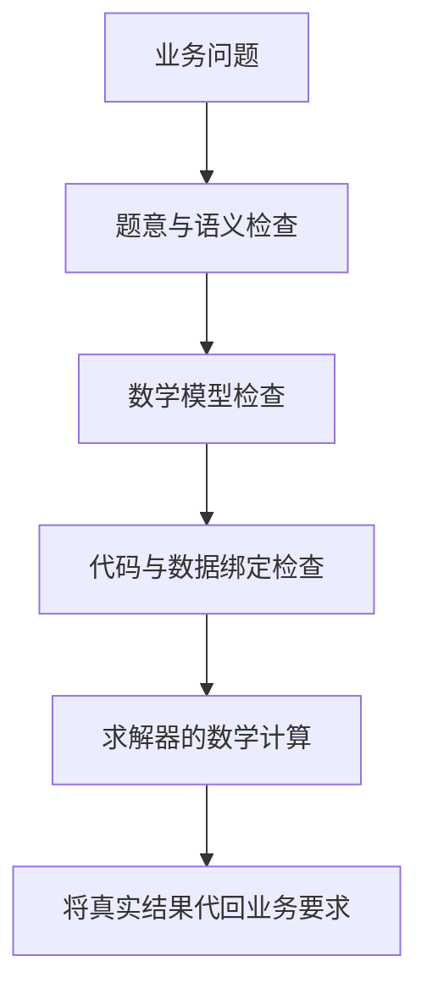

建模方法决定大模型怎样把问题变成公式与代码，以及何时检查、重试或比较候选。生成的模型交给求解器，计算决策变量与目标值。

## 先定位困难，再选择流程

| 你现在的主要困难 | 可先查看 | 重点观察 |
|---|---|---|
| 想快速得到第一个可核对模型 | [Direct](../direct/) | 变量域、约束和数据绑定 |
| 能运行，但怕漏规则或写反方向 | [Feedback Repair](../feedback-repair/) | 求解后的具体复核理由 |
| 需要区分题意、公式和实现错误 | [TriVAL](../trival/) | 分层验证与错误归因 |
| 规则多，想逐组件阅读 | [OptiMUS 0.3](../optimus/) | 约束检查、公式与代码的对应 |
| 想观察角色协作 | [Chain-of-Experts](../coe/) | 后续专家是否补充有效信息 |
| 想利用问题类型模板 | [OptiTree](../optitree/) | 匹配路径与模板适用性 |
| 想先写公式，再看执行和复查 | [OR-LLM-Agent](../or-llm-agent/) | 轮次、修复与实际执行版本 |
| 希望保留建模说明 | [ORThought](../orthought/) | 说明是否解释了具体表达选择 |
| 希望按五要素检查与返回修正 | [LLMOPT](../llmopt/) | 公式错还是仅代码错 |
| 想研究多个候选模型的搜索 | [AutoFormulation](../autoformulation/) | 剪枝、搜索奖励与最终排名 |
| 想逐约束核对代码含义 | [SAC-Opt](../sac-opt/) | 盲回译、冻结与选择性修正 |
| 大 JSON/CSV 不便放进提示 | [BIND](../bind/) | schema 与完整数据的执行绑定 |
| 想结合公开类型提示持续检查 | [OptiMind](../optimind/) | 提示范围及成功后的反馈 |

每种流程的完整机制、案例和当前参数都在相应文章中展开。

## 四种检查解决不同问题

语义检查问“每人最多五天是什么意思”；公式检查问“是否对每个人分别求和”；代码检查问“索引和变量域有没有写对”；求解器检查的是给定模型下的可行性和最优性。

同样是“修复”，有的方法只读执行错误，有的方法会复核题意，有的方法逐约束回译。比较方法时要看触发条件和返回位置。

## 用同一案例阅读不同流程

用完整生产题面运行时，Direct 一次生成公式与代码，再求解；Feedback Repair 在求解后追加原题复核；TriVAL 依次产生语义、公式和代码验证产物。可以打开各篇逐步案例，查看同一条规则如何进入这些阶段。

[快速开始](../quickstart/)提供题面、数据与操作录屏；[方法对比](../method-comparison/)提供并排运行入口。

## 调用成本由什么决定

Direct 的建模只有一次调用。Feedback Repair 无修复时为两次调用和一次求解。组件方法的调用随约束数增长；验证方法的调用随失败与回溯增长；AutoFormulation 默认会采样大量候选，属于明显更大的搜索预算。

运行耗时由模型服务延迟、附件规模、输出长度和求解难度共同决定。平台保存实际调用、用量与耗时，方法参数表则来自当前代码预设。

## 问题范围与组合

OptiMUS、CoE、OptiTree、OR-LLM-Agent、AutoFormulation 和 SAC-Opt 当前限定 LP/MILP。其他方法按具体模型、库和后端组合运行。九个库都可被方法选择，具体模型仍必须满足库与后端的能力。

例如 CPMpy 表达有限域离散决策，OSQP 处理连续凸二次规划，Ipopt 求光滑非线性模型的局部解。可通过[求解器指南](../solvers/)匹配这些结构。

## 怎样做有解释力的比较

固定题目、附件、模型预设、库、后端和运行限制，只改变一个要比较的因素。逐项记录：规则是否齐全、变量域是否正确、是否得到实际解、求解状态、额外验证是否通过、调用与求解次数。

从结果差异和失败阶段判断下一步：补充题意、改善数据说明，或选择更合适的检查流程。操作入口见[方法与模型对比](../method-comparison/)。
