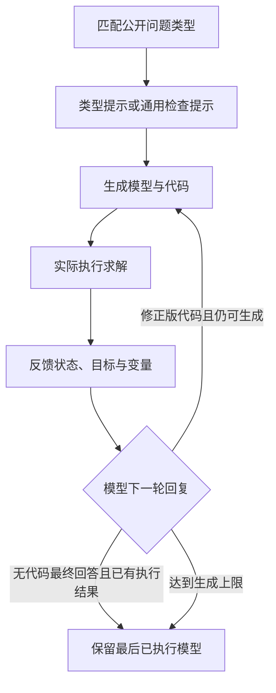

OptiMind 将公开的问题类型提示与多轮求解反馈结合。即使已经成功求解，它仍把结果反馈给模型，让模型检查是否需要修订，或用最终文字回答结束。

## 提示库能提供什么

类型提示用来提醒某类问题常见的建模错误。例如旅行商模型中，仅让每个城市恰好一进一出还可能形成多个子回路，需要额外保证整体巡回。

当前公开库只有 TravelingSalesman 一类、六条错误/提示对。平台分类只能选择公开类型或不匹配；不匹配时使用通用检查提示。

## 多轮流程与检查案例



```walkthrough
[
  {"title":"匹配提示","nodes":["Classify","Hint"],"body":"旅行商问题可匹配公开专项提示；其他类型没有公开专项条目时使用通用检查。","artifact":"示例：访问每座城市一次并回到起点。\n提醒：一进一出不自动排除多个独立子回路。"},
  {"title":"生成并求解","nodes":["Generate","Solve"],"body":"生成器需要把提示变成真正的约束，再由兼容后端执行。过程页可以查看提示内容与生成约束。","artifact":"检查二元边变量、每城入度/出度、子回路消除。\n数值结果由实际求解器计算。"},
  {"title":"成功后仍核对","nodes":["Feedback","Decision"],"body":"即使状态最优，也读取实际选边结果。多个闭环可能说明模型遗漏了连通性。","artifact":"若选边形成两个独立环：检查连通约束。\n若模型与要求一致：可最终回答结束。"},
  {"title":"结束一条轨迹","nodes":["Finish"],"body":"当前默认只有一条推理轨迹，没有多数投票。无代码的最终回答保留最后一次真正执行结果。","artifact":"最多 5 次生成；温度 0.6；top_p 0.95。\n文字完成不替代实际执行。"}
]
```

## 修订与结束的判据

求解反馈既包含失败，也包含成功的状态、目标和变量。模型可以给出新代码，继续生成—执行—反馈；已有有效执行结果时，也可以用不含代码的最终回答结束。

若还没有任何有效执行结果，缺代码的回复不算完成，会继续请求代码直到上限。最终数值来自最后已执行模型，不从最终文字中补造。

## 与其他流程怎样比较

[Feedback Repair](../feedback-repair/)有明确的接受或修复复核节点；OptiMind 的核心是类型提示与同一条轨迹中的持续反馈。[OptiTree](../optitree/)检索层次化类型条目，公开提示结构与作用也不同。

适合观察公开提示对建模与结果检查的影响。当前登记不统一限制为线性问题，仍需遵守具体库、后端和提示适用范围。训练权重、流程和专项提示是不同条件，应分别记录。

## 公开范围与平台实现

来自 [Microsoft OptiGuide/optimind 固定提交](https://github.com/microsoft/OptiGuide/tree/419cf7b9eee20b6af036abf15152fa775b20c951/optimind)。平台保存公开提示原文件，增加可选类型分类，改为原生模型契约和真实求解反馈。公开提示文件和适配流程均可从源码查看。
