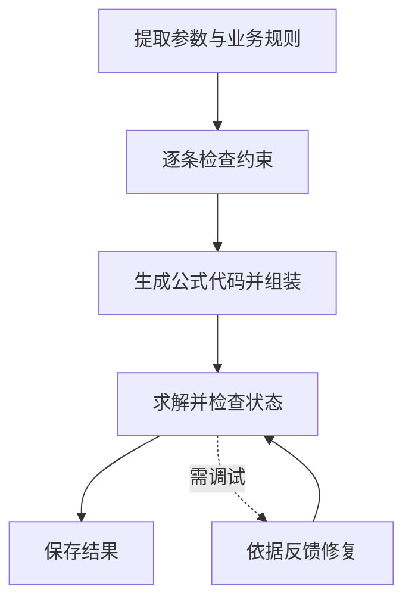

OptiMUS 0.3 按组件建立模型：先识别参数、目标和约束，再把每项约束写成公式与代码，最后组装并执行。它把一个长的生成任务拆成可以逐项阅读的中间产物。

## 从业务规则到模型组件

在生产案例中，“切割只有 8 小时”是一条业务描述；`2A+B≤8` 是它的数学表达；代码中的一条 Constraint 则是实现。OptiMUS 将这些信息关联起来，便于发现规则在转换过程中怎样变化。

目标与约束分别处理。约束列表还会经过冗余检查和逐条置信检查；低置信项可以保留、删除或修改。这些是大模型的判断，因此阅读者应核对它删掉的是重复表述，还是本来独立的业务要求。

## 执行流程与逐步案例



```walkthrough
[
  {"title":"参数与描述","nodes":["Params"],"body":"把利润、资源消耗和容量识别为参数。约束列表保留两种资源，分别记录各自的消耗系数。","artifact":"利润：A=3，B=2\nC1：切割容量 8，单耗 (2,1)\nC2：装配容量 8，单耗 (1,2)"},
  {"title":"组件检查","nodes":["Check","Assemble"],"body":"冗余检查去掉重复表述，保留切割与装配各自的系数和容量。","artifact":"C1 → 2A + B ≤ 8\nC2 → A + 2B ≤ 8\n变量必须保留非负整数域。"},
  {"title":"组装代码","nodes":["Assemble"],"body":"各组件的代码汇入同一个 build_model(data)。组件之间必须共享一致的变量名、索引和参数。","artifact":"setup + variables + C1 + C2 + objective + return model\n平台负责 solve，生成代码只负责构建。"},
  {"title":"执行调试","nodes":["Solve","Debug","Finish"],"body":"正确模型得到 A=3、B=2、利润13。若反馈触发调试，阅读改动是否保持了原来的组件含义。","artifact":"最多 3 次执行/调试尝试\n不可行或无界也可能进入这条调试路径。"}
]
```

## 参数数据与约束置信

附带上游格式的 `params.json` 时按其格式读取参数；否则从题面提取，包含实际取值。参数产物同时保存名称、形状、含义和实际取值。

约束检查使用五分制判断与有上限的重试。低置信项进入后续反馈，由该步骤决定保留、删除或修改；过程页可查看判断和更新后的约束。

## 与其他修复方法的差别

OptiMUS 的执行调试以最优状态为成功条件，也接受后端明确的局部最优状态并保留其含义。因此不可行或无界可能触发调试。与之相比，[Feedback Repair](../feedback-repair/)允许经过复核的真实不可行正常结束。

如果题目本来就可能无解，阅读调试时尤其要核对它是否改变了硬约束。若关心约束代码是否与文字一一对应，可同时了解 [SAC-Opt](../sac-opt/)。

## 使用范围与过程阅读

当前方法范围是 LP/MILP。选择方法后，按“参数—约束描述—公式—代码—执行”检查一条规则的完整路径。规则越多，逐项生成与检查的调用数越多；默认温度为 1.0，执行调试最多三次，组件检查与调试自动推进。

## 来源与平台适配

基于 [OptiMUS v0.3 固定提交](https://github.com/teshnizi/OptiMUS/tree/e182e9ef5841605c2a7e87467021fd83522b6484)，保留组件流程和提示，接入九个库的共享代码组件与沙箱。平台修复了分隔符和代码块解析问题，以保留实际生成内容；完整适配记录在原始方法文档中。
