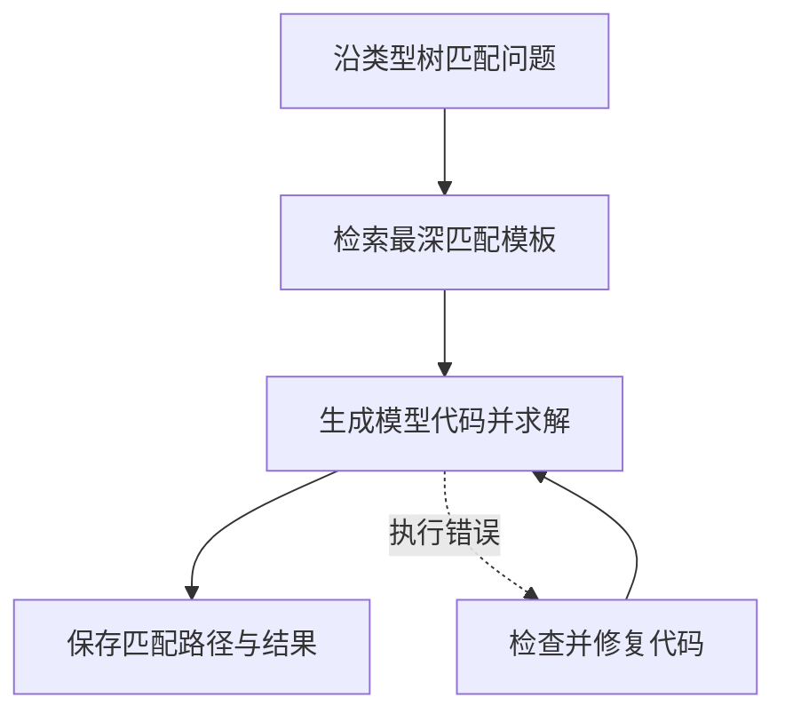

OptiTree 先沿问题类型树寻找匹配的建模思路，再让模型生成代码。它把“先识别属于哪类问题，再借用该类结构”的过程显式化。

## 分类树究竟提供什么

运输、指派、排班等问题在表面文字上不同，但常共享变量和约束结构。类型树提供已有的思路模板，帮助生成器从相关结构出发。生成器将模板结构与当前题目的费用、索引、容量和特殊规则结合。

分类从 Mixed Integer Programming 根节点开始，只在当前节点的子类型中选择，逐层下行。使用最深匹配节点的完整树条目作为推理上下文。

## 流程与检索案例



```walkthrough
[
  {"title":"识别结构","nodes":["Root"],"body":"以仓库到门店的运输问题为例，先识别流量分配、供给和需求结构。实际匹配路径由随包树和模型判断决定。","artifact":"题意：决定各仓库发往各门店的数量。\n输入：单位运费、仓库供给、门店需求。"},
  {"title":"使用模板","nodes":["Retrieve"],"body":"模板提示 x[i,j] 这种索引结构；当前题目提供供需规则与数值。","artifact":"x[i,j] ≥ 0\n仓库：sum_j x[i,j] ≤ supply[i]\n门店：sum_i x[i,j] ≥ demand[j]（仅当题意如此）"},
  {"title":"生成与执行","nodes":["Solve"],"body":"生成器结合最深匹配条目和当前数据写代码，平台实际执行。参数取值来自当前题目与附件。","artifact":"核对每个仓库、门店的索引及运费矩阵方向。\n特殊规则仍必须出现在最终约束中。"},
  {"title":"处理不匹配","nodes":["Inspect","Finish"],"body":"匹配结束时使用当前最深的有效条目。代码执行失败后进入检查员修复。","artifact":"未知类型 / 缺失判断 / 重复路径 → 停止下行\n代码检查最多 4 次。"}
]
```

## 为什么停止在较粗类型也有意义

过细且错误的分类会给生成器错误的结构。例如把可拆分运输量套成一对一指派，会凭空加入不允许拆分的要求。停在较粗类型，可以保留通用建模提示，同时让当前题意决定细节。

运行过程应同时看匹配路径、检索条目和最终模型。过程页提供匹配路径和检索条目，最终模型提供实际采用的变量与约束。

## 使用范围与其他方法

当前范围为 LP/MILP，默认温度 0，最多四次代码检查。它适合研究类型检索怎样影响建模。若主要需要逐项构建，查看 [OptiMUS](../optimus/)；若希望探索多个完整模型候选，查看 [AutoFormulation](../autoformulation/)。

## 来源与平台适配

来自 [OptiTree 固定提交](https://github.com/MIRALab-USTC/OptiTree/tree/2e70ecfd0a3c8e9c0c16d36d7d498a7344cfdec9)。平台随包分发原类型树和模板，保留分类、推理和检查提示，将代码目标改为所选库契约，并为未知类型、缺失字段和循环匹配增加明确停止处理。
