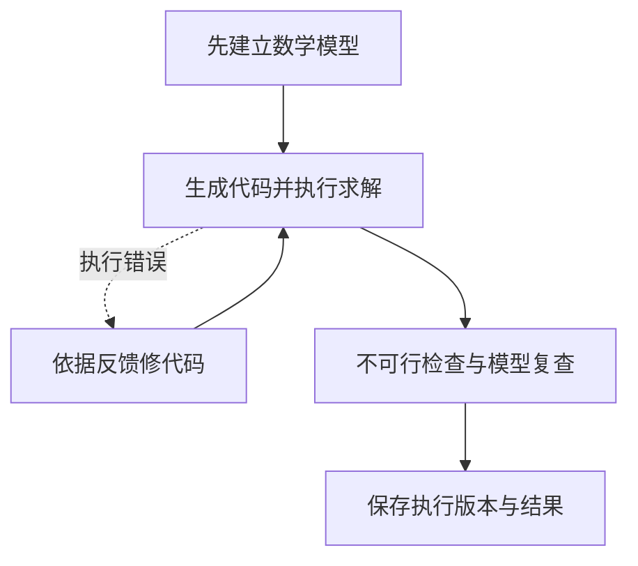

OR-LLM-Agent 先独立建立数学模型，再生成和执行代码。它保留主轮、不可行检查和复查等不同阶段，让执行反馈进入后续建模判断。

## 数学模型与代码分开有什么用

先写公式可以提供一个独立阅读点：用户无需从 Python 语法中反推目标和业务规则。代码出错时，也可以判断是实现偏离公式，还是公式本身需要复查。

例如运输问题中，仓库发货量上限、门店最低需求和运费目标应先清楚表达。若费用矩阵转置导致索引异常，这是代码问题；若门店需求方向写反，则需要检查数学表达。

## 流程与反馈案例



```walkthrough
[
  {"title":"先表达规则","nodes":["Form"],"body":"先检查运输模型的方向：仓库不能超供，门店不能少交。是否允许多交必须按题意决定。","artifact":"sum_j x[i,j] ≤ supply[i]\nsum_i x[i,j] ≥ demand[j]\nmin sum_i,j cost[i,j] × x[i,j]"},
  {"title":"定位执行错误","nodes":["Execute","Fix"],"body":"若代码访问 cost[j][i] 导致越界，反馈应推动索引修复。","artifact":"假设错误：运费矩阵按门店、仓库顺序读取。\n修复依据：实际数据为仓库行、门店列。"},
  {"title":"复查结果含义","nodes":["Round"],"body":"总供给小于总需求可能真实无解。复查应区分数据冲突与建模错误。","artifact":"供给合计 10，硬需求合计 12 → 可能真实不可行。\n复查记录会说明模型规则与供需数据。"},
  {"title":"核对代码版本","nodes":["Finish"],"body":"保留上游的轮次行为，最后一次修复可能尚未执行。数值只能关联真正执行过的代码。","artifact":"中间产物：最新修复建议\n最终数值：最后一次实际执行模型\n运行步骤标记各份代码的实际执行情况。"}
]
```

## 不同阶段的尝试预算

预设分别记录主轮 3、不可行检查 1、复查 2 的额度。修复对话在副本中进行，仅最后代码进入主对话。阅读步骤时，应结合轮次和实际执行记录。

## 与 Chat Agent 的区别

名字里的 Agent 指这条固定建模流程。[Chat Agent](../chat-agent/) 是面向用户的“优化对话”入口，可以调用 Direct、TriVAL 或其他方法，也负责解释结果、切换方案和比较场景。可在优化对话中指定 OR-LLM-Agent 作为本次建模方法。

## 何时使用与怎样核对

当前方法适用于 LP/MILP。适合想先阅读独立公式、再看执行修复与结果复查的用户。检查最终结果时，先找到最后一次实际执行，核对它的代码、状态、目标值和变量，再阅读后续修复建议。

## 来源与平台适配

来自 [OR-LLM-Agent 固定提交](https://github.com/bwz96sco/or_llm_agent/tree/5dccdaab89ab91c3cb28066fe849423dc124d287)。平台保留提示与恢复路线，把原 Gurobi 请求替换为所选库的 `build_model(data)` 契约，并在沙箱执行。修复建议保留为中间产物，数值结果关联对应的执行版本。
