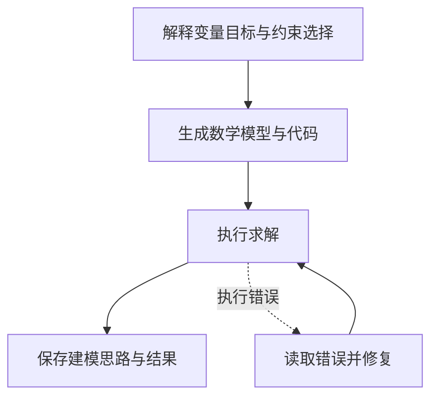

ORThought 让模型按专家建模的顺序写出思路，再汇总数学模型和代码。它将建模理由作为可阅读产物保存，帮助用户理解变量、目标和约束为什么这样定义。

## 建模思路应提供什么信息

有用的思路应解释具体选择。例如“产品按整件计，所以产量是整数”“工时按产品累加，所以容量约束是单耗乘产量之和”。建模路径将业务规则对应到变量域和具体数学表达。

当前采用上游 `formalized` 模式，输出建模路径、数学模型和代码三部分。过程页将建模路径作为独立的 solution_path 产物显示。

## 流程与建模路径案例



```walkthrough
[
  {"title":"确定决策","nodes":["Path"],"body":"先区分待决定的产量与已知参数。","artifact":"决定 A、B 的生产数量。\n已知输入：利润、工时和容量。"},
  {"title":"解释表达","nodes":["Path","Form"],"body":"将每条数学表达联系到具体业务含义。","artifact":"整件 → A、B 为非负整数\n工时累加 → 2A+B≤8，A+2B≤8\n总利润 → max 3A+2B"},
  {"title":"检查实现","nodes":["Execute","Debug"],"body":"若代码无法取得求解状态，调试器读取题目、公式、代码和实际错误后修复代码。","artifact":"执行错误 → 最多 3 次代码调试\n已得到 infeasible → 不因无可行解而调试"},
  {"title":"读回结果","nodes":["Finish"],"body":"正确整数模型得到利润13。将实际值代回思路中的资源表达，检查说明是否与计算一致。","artifact":"A=3，B=2\n切割 8；装配 7；利润 13\n文本解释应以这些真实值为依据。"}
]
```

## 执行修复与语义检查的边界

代码无法取得求解状态时进入调试，最多三次。若代码成功执行并返回不可行，当前流程不会只因为没有可行解而继续调试。这与 [OptiMUS](../optimus/) 的成功条件不同。

因此应区分“建模路径清楚”“代码可以执行”和“规则表达正确”。想增加明确的题意复核，可了解 [Feedback Repair](../feedback-repair/)；想看分层验证，可了解 [TriVAL](../trival/)。

## 适用场景与阅读方式

适合希望保留建模说明、用于学习和检查表达选择的工作流。按变量域和表达式结构选择建模库与后端，具体组合见求解器指南。运行记录保留建模路径、公式、代码与数值，便于联动阅读。

## 来源与平台适配

来自 [ORThought 固定提交](https://github.com/BeinuoYang/ORThought/tree/5293e24861a65d1e4a2f61f4fad0a81de901ee38)的 formalized 建模与求解流程。平台改为返回原生模型，在沙箱执行，保留 `solution_path` 产物。
