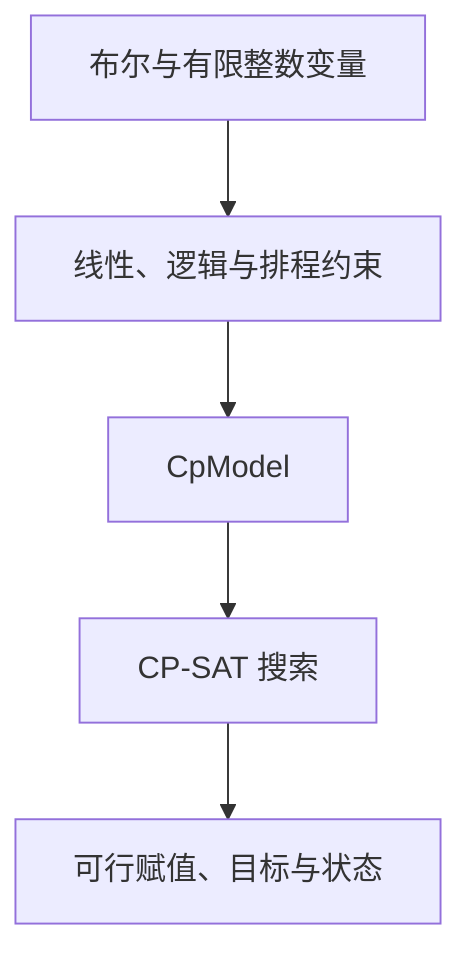

OR-Tools 提供数学规划、约束规划、路径和图算法等多种原生入口。平台按生成代码返回的模型识别接口，并使用对应的求解路径。

## 按任务选择原生接口

| 接口 | 适合表达 | 平台后端示例 |
|---|---|---|
| MPSolver / MathOpt / ModelBuilder | 线性、整数及接口支持的数学规划 | SCIP、HIGHS 等原生兼容引擎 |
| CpModel / CP-SAT | 有限整数、布尔、排班、逻辑 | CP_SAT |
| RoutingModel | 车辆、访问顺序、容量、时间窗 | ROUTING |
| 原生 Constraint Solver | 有限域约束与搜索 | CP |
| 最大流、最小费用流 | 网络弧、容量、费用与供需 | MAX_FLOW、MIN_COST_FLOW |
| 线性指派、背包 | 一对一匹配、受容量限制的选择 | ASSIGNMENT、KNAPSACK_* |

界面选择 OR-Tools 和后端，模型代码决定具体 API。默认数学规划参考使用 SCIP；选择 HIGHS 时可走 MathOpt。

## 一个完整的 CP-SAT 排班模型

四名员工各工作一天，周一和周二每天两人，费用矩阵如下。`x[e,d]` 表示员工 e 是否在日期 d 工作。

```python
from ortools.sat.python import cp_model

def build_model(data):
    costs = [[1, 7], [2, 8], [7, 1], [8, 2]]
    model = cp_model.CpModel()
    x = {(e, d): model.new_bool_var(f"work[{e},{d}]")
         for e in range(4) for d in range(2)}
    for e in range(4):
        model.add(sum(x[e, d] for d in range(2)) == 1)
    for d in range(2):
        model.add(sum(x[e, d] for e in range(4)) == 2)
    model.minimize(sum(costs[e][d] * x[e, d]
                       for e in range(4) for d in range(2)))
    return model
```

选择 `CP_SAT`。最优安排为员工0、1在周一，员工2、3在周二，总费用6。加入“员工0周二上班”后，最低费用为18。可在[场景比较](../scenarios/)中把这类人员变动作为独立场景计算。

## CP-SAT 的模型结构



整数域、布尔逻辑和区间变量适合表达离散排程。带小数的工时可先统一换成分钟或其他整数单位；题面和数据同时采用该单位，结果再按需要换算。

## Routing 和图算法的返回结构

Routing 需要同时返回模型和索引管理器，以便平台把内部索引还原为业务节点：

```python
return {"model": routing, "manager": manager}
```

最大流需提供源点和汇点；最小费用流通常直接返回原生模型。原生 Constraint Solver 返回模型及待读取的变量，优化时再提供目标和方向。完整结构见[原生接口参考](https://github.com/Fangziyang0910/LLM4OM/blob/main/docs/references/modeling-libraries.md)。

## 阅读结果与继续使用

CP-SAT 结果中的命名二元变量可以直接映射到人员与日期。Routing 结果按访问顺序阅读，同时看目标、状态和路径约束。结果页提供完整变量导出；之后可在[方案对话](../plan-chat/)中查询指定员工，或计算某一天的总费用。

原生用法见 [CP-SAT 指南](https://developers.google.com/optimization/cp/cp_example)、[Routing 指南](https://developers.google.com/optimization/routing/vrp)与 [MathOpt](https://developers.google.com/optimization/math_opt)。
