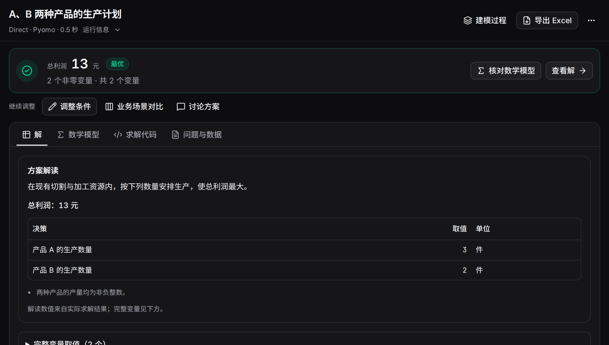

用一个生产问题走完描述、建模、求解、导出与条件调整。示例有完整题面、可下载数据和中英文工作台录屏。

## 1. 准备平台与预设

开始前，请确认：

- 浏览器能打开团队平台地址；没有服务时先[安装并启动](../installation/)。
- 至少有一个可调用的[模型预设](../model-presets/)。在左下角“AI 模型设置”检查服务商、接口地址、模型 ID 和密钥，保存后选择该预设。
- 自建服务的 Docker 引擎已启动，且已用 `uv run llm4om build-worker` 构建当前版本的 Worker 镜像。模型调用成功不代表求解环境也已就绪。

密钥只填写在本地设置或服务器环境中，不要写进问题描述或附件。需要中文说明时，先在“外观与语言”选择中文，再发起运行。

可以在“优化对话”发送问题，也可以从首页手动建模。下面使用 Direct、Pyomo 和 AUTO，便于跟随录屏。

## 2. 输入问题

```text
工厂生产A、B两种产品，产量均为非负整数。
A每件利润3元，占用切割2小时、装配1小时。
B每件利润2元，占用切割1小时、装配2小时。
切割和装配各有8小时可用。
请计算总利润最高的生产计划。
```

点击首页的求解按钮启动运行，查看生成公式、代码和求解的过程。先使用上面的完整题面，无需附件。数据版可下载 [JSON](../../../assets/examples/production.json) 或 [CSV](../../../assets/examples/production.csv)，将附件字段和两项容量写入题面后运行。

## 3. 查看方案并导出

结果应为 **A=3、B=2、总利润13元**。在“最优方案”读取产量，在“数学模型”和“求解代码”查看表达；顶部“导出表格”下载含方案与问题条件的 Excel 工作簿。

完成以下核对，才算跑通本例：

| 核对项 | 本例应满足 |
|---|---|
| 变量域 | A、B 均为非负整数 |
| 切割资源 | $2\times3+2=8$ 小时 |
| 装配资源 | $3+2\times2=7\le8$ 小时 |
| 利润 | $3\times3+2\times2=13$ 元 |

若模型或数值不同，先检查原题、附件、变量域和资源方向，再查看[失败阶段与完整错误](../troubleshooting/)。不要通过把小数四舍五入来代替整数约束。



“查看求解配置”保留方法、模型和后端选择；页面还显示耗时和调用量。点击“求解步骤”检查各阶段。原始模型输出默认收起，可手动展开；它可能包含英文协议字段，中文阅读视图不会因此改变保存记录。

## 4. 调整与比较

点击“调整条件”，输入“B至少生产3件，其他保持不变”。新方案为 **A=2、B=3、利润12元**，对比页显示与原方案的变化。

再使用“业务场景对比”，同时计算B至少3件与至少4件，两个场景利润分别为12与8。操作说明见[场景比较](../scenarios/)。

## 5. 跟着录屏操作

```video
workbench
```

录屏顺序：输入生产需求 → 查看利润13的方案 → 填写两个场景 → 比较13、12、8 → 打开数据编辑器 → 修改并保存单件利润。使用播放器控件暂停、开启字幕或全屏。

## 6. 在文档里先试一次

修改容量、最低需求或数量类型，查看对应方案，再下载CSV。准备好自己的问题后，可用[需求助手](../requirements/)整理规则，或直接进入[优化对话](../chat-agent/)。

```demo
production
```
