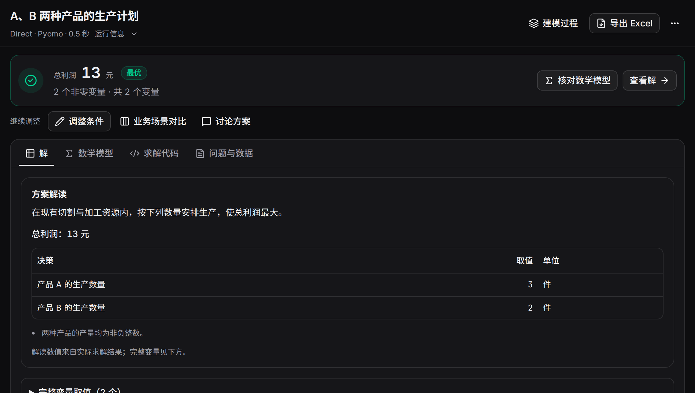

运行页将方案、数学模型、求解代码和过程放在一起。顶部先显示目标值与求解状态，下方可阅读业务解读、查看完整变量，或直接导出。

## 从结论进入细节

| 区域 | 内容 | 常用操作 |
|---|---|---|
| 顶部结论 | 状态、目标值、失败原因 | 跳到数学模型或解 |
| 方案解读 | 业务名称、单位、关键要求 | 了解主要决策 |
| 解 | 变量分组、列表、二维矩阵 | 筛选变量、下载 CSV |
| 数学模型 | 方法生成的数学表达 | 阅读各版本与差异 |
| 求解代码 | 原生库代码 | 对照变量、目标和约束 |
| 问题与数据 | 当时的题面和附件 | 查看输入快照 |
| 建模过程 | 各阶段调用与反馈 | 展开产物、错误和修订 |



## 读一份具体结果

生产案例的变量 A=3、B=2，总利润13。方案解读把变量关联到产品名称和“件”，目标关联到“总利润”和“元”；完整变量保留原名，便于对照代码。

二维变量按两个索引展开成矩阵，适合阅读人员×日期、仓库×门店等结果。切换列表可以查看原始变量名；筛选适合定位某个员工、产品或时间段。

## 选择合适的导出

| 导出 | 包含内容 | 适合用途 |
|---|---|---|
| Excel“求解方案” | 全部变量、零值、业务标签、单位、原名 | 执行安排与后续分析 |
| Excel“问题与条件” | 题面、变更、原问题、附件名、设置和链接 | 追溯方案输入 |
| CSV | 完整变量和值 | 表格分析、脚本处理 |
| Markdown 报告 | 问题、配置、结果、公式、代码、备注 | 阅读、归档与交流 |

点击顶部“导出 Excel”下载两张工作表。“更多操作 → 导出报告（Markdown）”生成报告。Markdown 结果节最多展示500个非零变量；Excel 与 CSV 保存完整变量。

## 方案解读与完整数值

方案解读使用本次预设生成业务名称、单位和简短说明，数值从求解结果读取。解读最多读取100个非零变量；完整变量区和导出用于查看全部数据。解读语言跟随启动时的界面语言。

“运行信息”显示模型预设、方法、实际后端、用时和调用量。需要检查某个中间模型时，在“建模过程”中找到对应执行与反馈。

## 从结果继续工作

“调整条件”创建新方案并显示前后差异；“业务场景对比”从当前方案批量计算；“讨论方案”在结果旁打开助手。可以先问“列出周二的安排”，再要求新的业务条件。

电脑端可拖动分隔线调整过程或助手的宽度；聚焦分隔线后也能按方向键调整。收起侧边面板后，模型和结果使用完整阅读区域。

## 看一遍操作

录屏展示生产方案、两种最低需求场景和附件编辑。可使用播放器字幕、暂停与全屏控件。

```video
workbench
```
