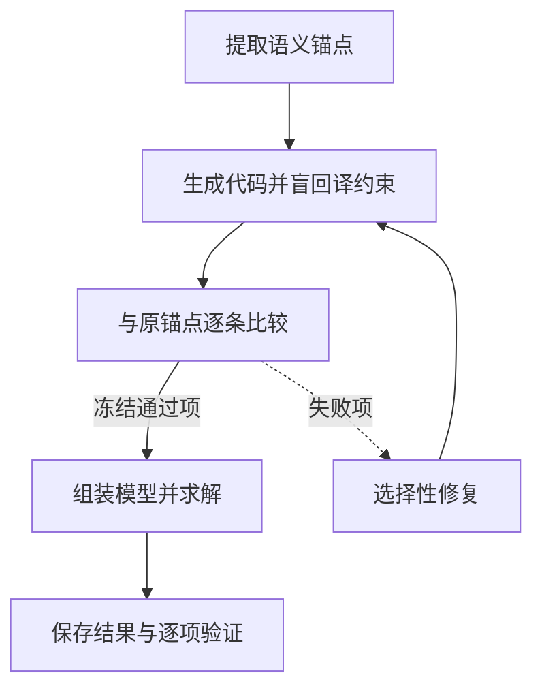

SAC-Opt 先把业务含义保存为语义锚点，再把代码中的约束翻译回自然语言，与原锚点比较。发现不一致时，只重写未通过的约束，已通过的组件保持冻结。

## 为什么要从代码反向阅读

以求和索引为例：“每位员工最多工作五天”应沿日期求和；代码若沿员工求和，可能变成“每天最多五名员工”。二者都可能语法正确、可执行，但表达了不同规则。

回译器读取当前约束代码及必要上下文，产出代码所表达的规则。比较器再将回译与原语义锚点逐条比较，形成通过或修复判断。

## 流程与逐约束案例



```walkthrough
[
  {"title":"保留锚点","nodes":["Anchors"],"body":"用员工 e、日期 d 定义二元变量 x[e,d]。把原要求固定成带索引含义的语义锚点。","artifact":"变量：x[e,d] = 1 表示员工 e 在日期 d 工作。\n锚点 C1：每位员工的工作天数 ≤ 5。\n锚点 C2：每天至少 3 人。"},
  {"title":"盲回译","nodes":["Generate"],"body":"假设 C1 的代码错误地沿员工求和。回译会暴露它实际限制的是每日人数。","artifact":"假设错误代码：对每个 d，sum(x[e,d] for e in E) ≤ 5\n回译：每天最多安排 5 人。"},
  {"title":"选择性修正","nodes":["Compare","Repair"],"body":"C1 的量词和求和方向不一致，修它；C2 若已通过就冻结，避免无关改写引入新错。","artifact":"修正 C1：对每个 e，sum(x[e,d] for d in D) ≤ 5\n冻结 C2：对每个 d，sum(x[e,d] for e in E) ≥ 3"},
  {"title":"组装并执行","nodes":["Assemble","Finish"],"body":"语义组件检查后组装代码，实际求解。若语义轮次用尽仍有失败，保留产物并明确报告。","artifact":"语义一致性：逐约束记录\n可执行性：由完整程序执行检查\n数值方案：由真实后端返回"}
]
```

## 四类锚点如何进入代码

参数与变量锚点记录符号、形状、单位、变量域与上下界。当前实现中，参数和变量的置信评分大于 3 才保留；低置信约束会再判断是否修正。代码按 setup、目标、各约束分项生成，组件数量与锚点对应。

附件仍通过 `build_model(data)` 读取完整数据。批量提交多个待检查组件只减少编排开销，每条约束仍分别判断。

## 上限和失败结果怎样理解

默认解析最多五次、语义比较最多五轮、完整程序执行最多三次。语义检查与执行调试是两个不同循环：前者检查含义，后者处理完整程序的运行问题。

最后一轮语义比较失败时，平台保存未通过的组件、验证反馈和真实求解结果。阅读时要同时看哪些约束未通过，以及求解结果对应哪份代码。

## 何时考虑这条流程

适合线性或混合整数模型中规则很多、索引和量词容易写错、又希望检查到单条约束的场景。与 [TriVAL](../trival/) 相比，它把检查集中在锚点与约束代码的对应关系；与 [Feedback Repair](../feedback-repair/) 相比，修复粒度更细。

## 平台实现与来源

依据 [SAC-Opt 的公开算法](https://proceedings.mlr.press/v306/zhang26cb.html)独立实现，提示由本项目编写。固定参考提交见 [Forrest-Stone/SAC-Opt](https://github.com/Forrest-Stone/SAC-Opt/tree/ec0ddb544ae6b70714181740ebbba16027df50e4)。平台保留锚点、盲回译和选择性修正机制，采用批量组件处理与统一原生代码契约。
