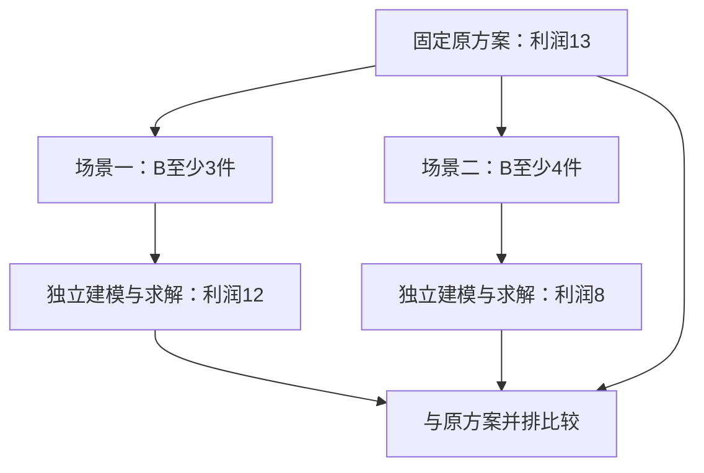
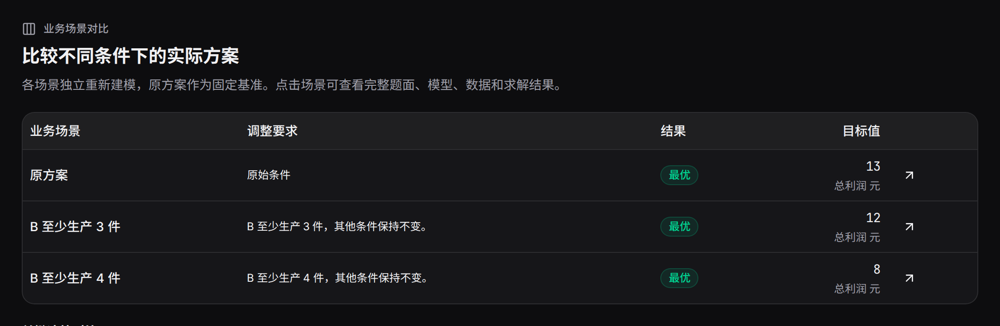

业务场景对比从一份方案出发，分别计算多个明确条件。它适合比较不同需求、预算、产能、人员可用性或供应变化。

## 建立一组场景

在结果下方点击“业务场景对比”，填写2至6个场景的名称和变化。名称用于辨认结果，变化写入新题面。点击“计算并对比”后，各场景使用共同输入与原配置运行。

```text
场景一：常规订单，B至少生产3件。
场景二：增加B订单，B至少生产4件。
```

也可在方案对话中一次提出多个场景，完成后打开“对比本轮方案”。

## 共同基准怎样分支



每个场景保存自己的完整题面、代码、求解与结果。场景对话保留原来的当前基准，后续可明确选择某个场景继续调整。

## 一个完整比较表

| 方案 | A | B | 利润 |
|---|---:|---:|---:|
| 原方案 | 3 | 2 | 13 |
| B至少3件 | 2 | 3 | 12 |
| B至少4件 | 0 | 4 | 8 |



先看场景状态和目标，再看发生变化的变量。对比页优先展示前20个变化的同名变量，点击单个运行可以查看完整结果和输入。

## 试着生成并选择场景

点击“比较 B ≥ 3 与 B ≥ 4”生成两个场景，再点击下方保存的“B ≥ 4”方案。顶部当前讨论方案随之更新；点击“查看资源使用”，会读取所选场景的产量与工时。

```demo
plans
```

## 怎样组织有用的场景

| 业务问题 | 可以设置的变化 |
|---|---|
| 需求增长 | 分别提高各产品或门店需求 |
| 人员缺席 | 固定某员工某天不可用 |
| 预算协商 | 不同总预算上限 |
| 设备维护 | 降低指定日期产能 |
| 供应波动 | 改变某仓库供给或禁用路线 |

为每个场景写完整的对象与取值；保留一致的目标含义和单位，便于读表。需要连续累积的变更，可逐次使用[调整条件](../revisions/)。

## 录屏与结果归档

录屏中间展示场景填写和对比表。每个场景都有独立链接，可导出 Excel、添加标签并记录结论。

```video
workbench
```
