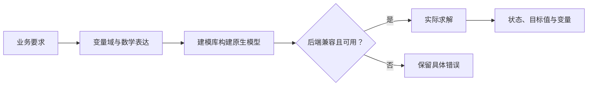

先判断需要什么数学模型，再选择建模库和求解后端。库负责表达模型，后端负责计算。

## 从变量与约束开始选

| 问题结构 | 数学含义 | 可以先看的组合 |
|---|---|---|
| 可分割数量，线性成本与容量 | LP：连续线性规划 | Pyomo / PuLP + HiGHS 或 CBC 等兼容引擎 |
| 整件、开关、选址，线性约束 | MILP：混合整数线性规划 | Pyomo、PuLP、gurobipy、PySCIPOpt、coptpy；或 OR-Tools 数学规划接口 |
| 排班、逻辑、互斥、有限域 | CP / SAT 类离散约束 | CPMpy + OR-Tools，或 OR-Tools CP-SAT |
| 凸二次损失、范数、锥约束 | 凸 QP / 锥规划 | CVXPY + 对应的 OSQP、Clarabel、SCS 等 |
| 光滑非线性、连续控制量 | NLP：非线性规划 | CasADi + Ipopt，或适合该模型的其他原生路径 |
| 路径、流、指派、背包 | 专门组合结构 | OR-Tools 对应的 Routing、流或组合算法 |

“排班”也可以写成 MILP，“生产”也可能含非线性损耗。决定兼容性的是变量域和表达式结构。

## 一条完整的求解链



方法负责把题意转成数学模型；建模库把表达组织为原生对象；后端用算法处理这个对象。库内 API 属于代码选择，例如 OR-Tools 的 CpModel 与 MathOpt，作为库内原生 API 使用。

## 动手使用生产模型

生产示例可以修改工时、最低需求和数量类型，并即时查看产量、目标值与资源使用。

```demo
production
```

选择适合的模型后，可以在工作台运行相同题面，保存模型、代码与完整结果，再继续调整条件。

## 九个建模库各自擅长表达什么

| 库 | 表达与接口 | 默认或原生计算路径 |
|---|---|---|
| [Pyomo](../pyomo/) | 代数、索引模型；Concrete/Abstract 实例、Kernel | 代数默认 HiGHS；Kernel 默认 CBC |
| [gurobipy](../gurobipy/) | Gurobi 原生标量与矩阵模型 | Gurobi |
| [OR-Tools](../ortools/) | 数学规划、CP、Routing、网络算法 | 按原生接口；MPSolver 参考默认 SCIP |
| [CPMpy](../cpmpy/) | 有限域整数、布尔、全局约束 | 默认 OR-Tools CP-SAT |
| [PuLP](../pulp/) | 线性目标和线性约束 | 默认 CBC；其他原生兼容后端 |
| [CVXPY](../cvxpy/) | DCP、DGP、DQCP；凸与锥表达 | 按模型与安装路径选择 |
| [PySCIPOpt](../pyscipopt/) | SCIP 原生线性、整数和非线性约束 | SCIP |
| [CasADi](../casadi/) | 符号微分、Opti、NLP/Conic 字典 | Opti NLP 默认 Ipopt |
| [coptpy](../coptpy/) | COPT 原生 LP/MIP、凸二次与锥 | COPT |

## AUTO 与显式选择

AUTO 使用库和返回模型的原生逻辑。CVXPY 可按兼容 `solver_path` 尝试已安装后端；固定原生库使用自己的引擎。最终结果记录实际后端。

显式选择用于固定计算引擎。运行信息记录该选择和实际执行反馈，依赖安装与许可配置见[后端与许可证](../backends/)。

## 怎样读求解状态

`optimal` 表示对提交模型取得最优结论；`feasible` 表示有合法方案但没有相同强度的最优结论；`infeasible` 表示该模型没有可行解。`time_limit` 需继续看是否保留可行方案。

非凸 NLP 使用 locally_optimal 等局部状态；Routing 的启发式结果按原生状态记录为 feasible 或 optimal。结果页保留这些状态及实际变量。

## 代码如何交给平台

通常定义 `build_model(data)` 并返回原生模型。代码只构建，不调用 solve、不打印方案，也不自行读文件或网络。平台传入完整附件文本，负责执行、时限、求解和结果保存。Routing 的管理器、流的源汇、CasADi 数值参数等特殊返回结构，在各库文章提供实例。
