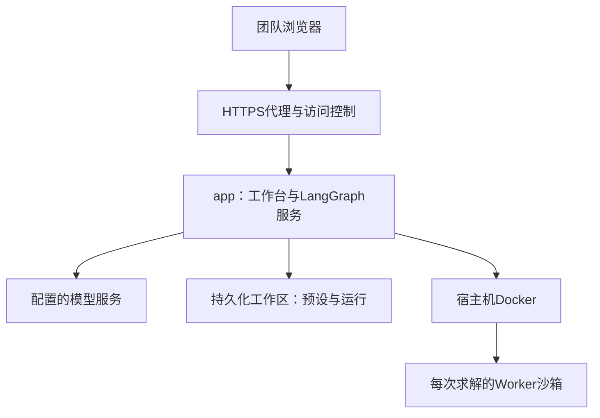

团队部署将模型配置、运行记录和工作台集中在服务器上，成员通过浏览器访问。本文按启动、共享访问、HTTPS和维护的顺序完成部署。

## 启动服务

服务器准备Docker和Compose v2.24或更新版本，按[安装指南](../installation/)克隆仓库并填写 `.env`，然后执行：

```bash
docker compose up -d --build
docker compose ps
docker compose logs -f app
```

默认端口8767。局域网成员可使用 `http://服务器IP:8767`，端口映射通过 `LLM4OM_PORT` 配置。

## 服务组成



app通过宿主机Docker socket创建Worker。Worker采用无网络、只读根文件系统、非root和运行限额，完成后删除。数据卷 `llm4om-data` 保存预设、历史和运行记录。

## 共享访问配置

工作台采用共享工作区：成员可以使用预设、查看运行、修改备注与管理记录。用团队IP范围或带登录的反向代理配置服务入口，访问控制在该入口完成。

Docker socket使app具备创建宿主机容器的权限，部署机器按这一权限配置。服务默认预设、每日额度与并发见[配置指南](../configuration/)。

## 配置域名与HTTPS

将域名解析到服务器，开放80与443端口。在 `.env` 设置实际域名：

```dotenv
LLM4OM_DOMAIN=llm4om.example.edu
LLM4OM_PORT=127.0.0.1:8767
LLM4OM_TRUST_PROXY=1
```

然后运行：

```bash
docker compose --profile https up -d --build
docker compose logs -f https
```

Caddy申请并保存证书，将页面和实时运行流转发到app。`LLM4OM_TRUST_PROXY=1`使运行额度按转发的客户端地址计数。

## 调整并发和资源

在 `compose.override.yaml` 配置活动运行数，例如：

```yaml
services:
  app:
    command: ["llm4om", "serve", "--workspace", "/data", "--port", "8767", "--jobs", "8"]
```

沙箱总并发由 `.env` 的 `LLM4OM_SANDBOX_JOBS` 单独控制，涵盖求解和方法检查脚本。根据模型服务额度与机器资源选择数值。

## 更新、迁移与备份

更新执行 `git pull`，再运行 `docker compose up -d --build`。环境变量修改后执行 `docker compose up -d app`。停止服务使用 `docker compose down`，数据卷继续保留。

从原Python服务迁移时，停止目标app，把旧工作区复制到 `/data/`，再启动。备份与恢复命令见[配置与备份](../configuration/)，商业许可挂载见[后端指南](../backends/)。
