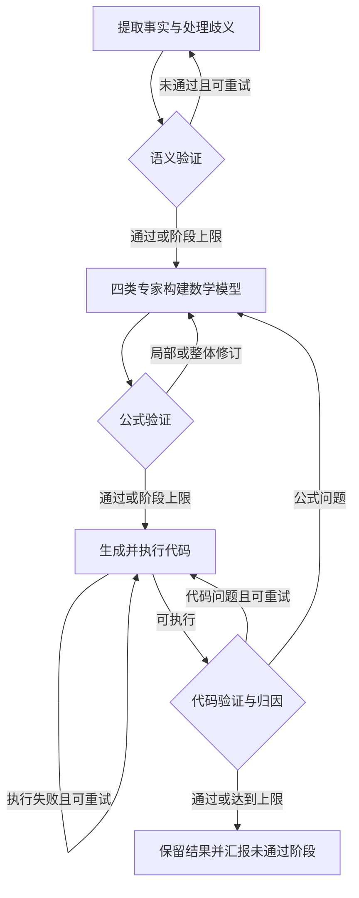

TriVAL 将自动建模分成三个需要分别核对的层次：是否正确理解了题意、数学模型是否表达了这些理解、代码是否实现了数学模型。每层都有构建、验证和修订，代码问题还可以回溯到公式层。

## 三层验证分别在检查什么

| 层次 | 主要产物 | 典型错误 | 修订方向 |
|---|---|---|---|
| 语义 | 事实、歧义及其处理 | 把“每个班次”理解成“全天合计” | 重提事实或重新处理歧义 |
| 数学模型 | 参数、索引、变量、目标、约束 | 遗漏逐班覆盖约束，或把最低量写成上限 | 局部修订或重新构建公式 |
| 代码 | 原生模型代码、执行结果 | 索引错位、变量类型错误、代码与公式不一致 | 修代码；若根因在公式则回溯 |

这种区分让修复落在错误产生的位置：语义提取、数学表达或代码实现。

## 流程与可逐步查看的案例



```walkthrough
[
  {"title":"语义事实","nodes":["Facts","Sem"],"body":"用生产案例区分利润、工时、资源上限与整件要求。假设题目另说 B 至少 3 件，这必须被保留为最低需求事实。","artifact":"事实：A、B 为整件产品；资源各 8 小时；B 至少 3 件。\n歧义核对：收益是单件净收益，工时是每件工时。"},
  {"title":"构建公式","nodes":["Form","FCheck"],"body":"参数/索引、变量、目标和约束专家并行构建，选择器汇总，再核对语义事实是否都有数学对应。","artifact":"max 3A + 2B\n2A + B ≤ 8；A + 2B ≤ 8；B ≥ 3\nA, B ∈ 非负整数"},
  {"title":"执行与归因","nodes":["Code","CCheck"],"body":"假设代码漏掉 B ≥ 3，公式本身正确，应修代码；若公式也遗漏，则回到公式层。","artifact":"代码层遗漏 → 修 build_model(data)\n公式层遗漏 → 回溯数学模型，再重写代码\n这两条修复路线解决不同根因。"},
  {"title":"分别报告","nodes":["Finish"],"body":"正确模型的整数最优收益是 12。即使求解器返回 optimal，某层验证仍未通过时，运行也应明确保留这个问题。","artifact":"求解证据：A = 2，B = 3，收益 12\n方法验证：语义 / 公式 / 代码分别记录\n达到次数上限 ≠ 验证通过"}
]
```

## 验证失败后怎样前进

语义层分别判断事实是否忠实、歧义是否相关、处理是否一致。事实或歧义识别有问题时重新提取；主要是处理不一致时重新处理歧义。公式层可做局部修订，也可重新调用构建专家。

代码先执行，能执行后才进行代码验证。代码检查将错误归因到公式时，外层图重新进入公式验证。阶段次数达到上限时，上游流程可能带着最新产物继续；平台出口会汇报仍未通过的阶段。

## 看过程时重点看哪些信息

先从原题选一条容易误解的规则，沿语义事实、公式和代码追踪它。例如“每位员工最多五天”应有逐员工索引，并对每位员工建立相应约束。再检查验证者提出的问题有没有被后续产物实际修正。

最终结果同时保存求解数值和各阶段验证反馈。方法比较可以读取求解状态、未通过阶段、修订位置和实际调用用量。

## 使用条件与预算

在运行设置选择 TriVAL，并选择支持目标数学类型的库和后端。每阶段最多五次验证，代码执行最多二十次；节点数和返回路径使总调用数随问题变化。

DeepSeek 的强制工具选择与思考模式存在兼容要求。使用该服务时，预设额外参数应包含 `{"thinking":{"type":"disabled"}}`，详见[大模型预设](../model-presets/)。

## 与其他方法及原始实现的关系

[Feedback Repair](../feedback-repair/) 在求解后整体复核；TriVAL 把检查前移并分层。[SAC-Opt](../sac-opt/) 聚焦约束代码的回译一致性，检查粒度不同。

平台移植 [SCUT-EIPI/TriVAL 的固定实现](https://github.com/SCUT-EIPI/TriVAL/tree/380a529)，保留图、节点、提示和循环，接入平台 LLM 与沙箱，并增加输入映射和未解决验证的退出报告。
